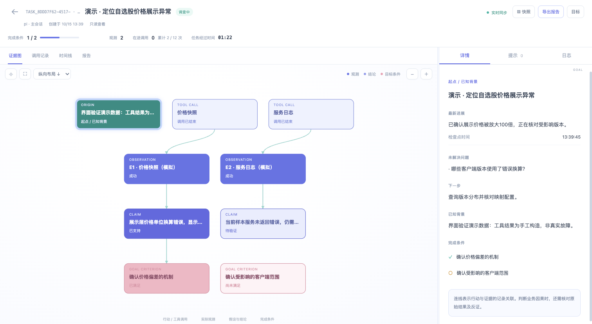

# Cairn

[English](README.md) | 简体中文

**为 Pi、Claude Code、Codex 保留目标、证据链和可恢复的进度。**

Cairn 2.1 将模型的操作收敛为五个工具：**开始、恢复、读取、阶段记录、结束**。模型照常使用宿主工具，在得到有价值的结论时一次记录证据与目标覆盖情况。简单任务可以直接结束，无需逐项维护结论 ID、完成条件关联和报告引用。

模型、账号、会话、工具审批和并发由原有 CLI 管理。Cairn 使用 TypeScript 与 SQLite 保存任务记录，并提供蓝白配色的只读进度看板。

## 快速开始

需要 **Node.js 24 或更新版本**。先在 Cairn 仓库根目录安装全局命令：

```sh
npm install
npm run install:global
cairn --version
```

安装脚本自动构建、打包，再安装一份独立的全局副本。**本流程安装当前仓库的构建产物，无需 npm registry 上已有 Cairn 包。** 安装完成后，在任意项目目录都可以直接执行 `cairn`，无需输入 `node bin/cairn.mjs`，也不依赖当前终端位于源码目录。

如果 npm 默认全局目录不可写，可选择用户目录：

```sh
npm run install:global -- --prefix "$HOME/.local"
export PATH="$HOME/.local/bin:$PATH"
cairn --version
```

脚本还支持 `--cache DIR` 和 `--offline`；离线安装要求仓库依赖已准备好。

接着进入要使用 Cairn 的项目，安装相应宿主的适配包；实际执行需要目标 CLI 已安装并配置好账号或模型。

```sh
cd /path/to/your-project

# 按实际使用的宿主选择；默认安装到当前项目。
cairn install --target pi
cairn install --target claude
cairn install --target codex
cairn ui
```

安装后开启新的 CLI 会话。Codex 需要信任项目，并通过 `/hooks` 检查和信任 Cairn hooks。需要跨项目使用时，给安装命令增加 `--scope user`；`--root DIR` 可指定安装根目录。

直接向 Agent 描述目标即可：

> 使用 Cairn 排查这个接口为什么超时。先做最有价值的查询，保留支持与反驳证据；得到阶段结论时保存进度。最终说明影响面、根因和解决方案。如果证据不足，保存缺口并暂停。

或者：

> 用 Cairn 跟踪这次修改，目标是修复解析错误并通过现有回归测试。照常使用代码工具，完成时给出证据支持的结果。

只有开始或恢复 Cairn 任务后，相关 hooks 才处理任务状态。普通 CLI 工作仍可按原有方式进行。

## 完整样例：先看链路，再交给真实模型

无需模型账号即可运行：

```sh
cairn demo
```

命令创建隔离的临时工作区，打开蓝白看板服务，按节奏执行价格异常诊断：目标创建 → 健康检查反证 → 价格样例 → 阶段记录 → 暂停 → 新会话接管 → 单位映射与影响面取证 → 校验完成与导出。终端会打印看板地址和样例目录；完成后看板继续保持前台，按 Ctrl+C 关闭。

这是固定步骤驱动的演示，使用真实 stdio MCP 和 Cairn 网关采证，数据来自本地模拟工具，**不冒充真实模型推理或主办方比赛数据**。

```sh
# 自动选一个空闲看板端口
cairn demo --port 0

# 无界面、零延迟执行，输出 JSON 结果及产物路径
cairn demo --no-ui --delay 0 --json
```

要让真实 Agent 自行排查，先准备一个新的工作区：

```sh
unset CAIRN_WORKSPACE
cairn demo --prepare --target codex --root ./cairn-example
cd cairn-example
export CAIRN_DB="$PWD/.cairn/state.db"
codex
```

告诉 Agent：“读取 `PROMPT.md`，使用 Cairn 完成其中的诊断目标。” 也可以将 `--target codex` 改为 `pi` 或 `claude`，再启动对应 CLI。准备命令只生成样例、配置受控工具并安装适配包，不会自动启动模型。另开终端进入同一样例目录，执行 `cairn ui --db "$PWD/.cairn/state.db" --port 0` 即可观察。

这里显式设置样例数据库，确保样例位于其他 Git 仓库内部时也使用自己的记录。`CAIRN_DB` 只在本次样例终端设置；做其他项目时使用新终端，或在结束后执行 `unset CAIRN_DB`。

指定的样例目录非空时命令会拒绝覆盖。完整输入、返回、证据与目标关联、暂停恢复及产物说明见 [价格异常诊断完整样例](docs/examples/price-incident.zh-CN.md)。

## 模型的最短使用流程

### 开始 → 原生工具 → 结束

以下是调用格式示例。Claude Code／Codex 的 MCP 连接在首次 `cairn_start` 或 `cairn_resume` 时，使用启动 hook 提供的真实 `session_id`；Pi 自动绑定原生会话，省略该字段。后续操作均使用当前绑定，无需重复传会话或任务 ID。

**1. `cairn_start`**：只给目标即可，未提供 `criteria` 时，目标本身成为唯一完成条件 `c1`。

```json
{
  "session_id": "HOST_SESSION_ID_FROM_STARTUP",
  "goal": "确认 package.json 中的项目名称"
}
```

**2. 使用宿主原生工具读取 `package.json`。** 已接入的工具结果由 hook 自动记录，并返回类似 `Cairn E1` 的提示。`E1` 是该任务内的稳定证据别名；以实际返回的别名为准。

**3. `cairn_finish`**：一次写入结论、生成报告引用并检查完成。

```json
{
  "summary": "已确认项目名称为 cairn。",
  "findings": [
    {
      "text": "package.json 的 name 字段为 cairn。",
      "evidence": ["E1"]
    }
  ]
}
```

单一完成条件会自动关联新增的已支持结论。程序验证证据属于当前任务、状态成功、范围合适，以及报告覆盖完成条件。通过后返回 `status: "completed"`；缺少证据或条件未满足时，任务保持 `active`，返回 `phase: "incomplete"` 和具体缺口。

这个例子说明接口形态，并不意味着所有原生工具路径都能被 hook 捕获。没有收到证据提示时，先用 `cairn_read` 检查证据索引和 `doctor` 观察记录。

### 长任务：一次保存阶段进展

只有在形成结论、发现反证、改变方向或需要暂停时，调用 `cairn_checkpoint`：

```json
{
  "summary": "应用进程正常，超时与连接池耗尽相关，仍需定位连接未释放的路径。",
  "findings": [
    {
      "key": "pool-exhaustion",
      "text": "超时发生时连接池持续处于上限。",
      "evidence": ["E2", "E3"],
      "covers": ["c1"]
    },
    {
      "key": "process-crash",
      "text": "进程崩溃导致本次超时。",
      "against": ["E1"],
      "status": "refuted"
    }
  ],
  "questions": ["哪些请求路径没有归还连接？"],
  "next": "查询连接占用栈并与超时窗口对齐。"
}
```

- `key` 是模型自行选择的可读标识；下次使用同一个 `key` 会修订原结论。
- `evidence` 是支持观测，`against` 是反驳观测。可使用 `E#`、原始观测 ID 或任务内无歧义的真实 `result_ref`。
- 新增结论的 `status` 可省略：仅有支持证据时为 `supported`，仅有反证时为 `refuted`，两者都有时为 `inconclusive`，都没有时为 `proposed`。修订已有 `key` 时默认保留原状态；新增反证可以降级，清除反证后需明确声明 `status: "supported"` 才会升级。
- 多个完成条件用 `covers` 关联 `c1`、`c2` 等；核心批量维护结论、覆盖关系和报告引用。
- `questions` 保存未解决问题，`next` 保存下一步。无需登记每次思考或每个工具调用。

`cairn_finish` 接受相同的阶段内容，简单任务无需先调用 checkpoint。已经保存完内容后，可用 `cairn_finish {}` 检查并完成；无新增内容地重试已完成操作会返回已有状态。

### 五个固定工具

| 工具 | 用途 |
| --- | --- |
| `cairn_start` | 创建目标、约束与预算；完成条件默认使用目标 |
| `cairn_resume` | 恢复或显式接管任务，并绑定当前连接 |
| `cairn_read` | 读取摘要、原始证据、分页历史或任务列表 |
| `cairn_checkpoint` | 批量记录结论、反证、目标覆盖、问题和下一步 |
| `cairn_finish` | 一次保存并校验完成，或保存未完成进度后暂停 |

配置上游白名单后，另增加按原参数结构暴露的 `cairn_tool_*` 工具。旧版 16 工具接口不再作为公共兼容接口。

## 三种 CLI 的适配与能力

| 宿主 | 安装与运行方式 | 会话与证据 |
| --- | --- | --- |
| Pi | 自包含原生 package、扩展和共享 skill | 原生会话自动绑定；工具事件自动采证，回合前恢复摘要 |
| Claude Code | 本地 marketplace 原生插件，含 skills、hooks、stdio MCP | 首次 start／resume 使用启动 hook 的真实会话 ID；后续连接内自动绑定 |
| Codex | 项目级／用户级 hooks、MCP 和 skill；同时生成 marketplace 插件包 | 同上；项目级安装使用原生配置登记，hooks 需要宿主信任 |

构建产物位于 `dist/plugins/pi`、`dist/plugins/claude` 和 `dist/plugins/codex`。每个包包含自己的运行时，可独立于源码目录移动。

其他 MCP 客户端可以运行共享 stdio 服务，并加载 `skills/cairn`：

```sh
cairn mcp --host mcp --session-id my-task-session
```

**仅接入 stdio MCP 不会自动捕获宿主原生工具。** 这时可以使用配置好的 `cairn_tool_*` 自动取证。新版不提供让模型手动登记观测的工具；历史手动记录仍保留原始来源标记。hooks 缺失时，相应的原生捕获与恢复能力也不可用；严格应急 Profile 缺少所需接入能力时会拒绝启动或恢复。

```sh
cairn doctor --target pi
cairn doctor --target claude
cairn doctor --target codex
```

`doctor` 区分适配包**声明支持的能力**与**实际观察到的事件**，显示版本、安装、MCP、上游目录和 hooks 启动观察状态。配置文件存在、MCP 连通或 `startup_observed` 都不能证明每类工具调用都经过 hook。Codex 托管工具和部分特殊路径可能绕过本地 hooks；严格取证任务应使用受控网关工具。

## 暂停、恢复与按需读取

需要暂停时，让 Agent 调用：

```json
{
  "outcome": "suspended",
  "summary": "已定位连接池耗尽，等待获取调用栈。",
  "questions": ["缺少连接占用栈。"],
  "next": "取得调用栈后继续定位。"
}
```

这是 `cairn_finish` 的参数。用户中断优先，暂停后不会收到自动续跑提示；完成检查只允许有界补充提示。

新会话或跨 CLI 恢复时告诉 Agent：

> 使用 Cairn 恢复任务 TASK_ID，并明确接管（takeover=true）。先查看保存的目标、阶段结论、未解决问题和下一步，再按需读取证据。

`cairn_resume` 的示例参数：

```json
{
  "session_id": "NEW_HOST_SESSION_ID_FROM_STARTUP",
  "task_id": "TASK_ID",
  "takeover": true
}
```

接管递增执行代次，旧会话不能提交迟到的完成结果；迟到观测仅保留审计用途。同一宿主会话重新建立 MCP 连接也需要绑定一次，但未变更负责人时无需接管。恢复的是 Cairn 状态，原生聊天历史仍由宿主保存。

恢复摘要控制在 **16 KiB 以内**，带有总量和截断标记。原始记录保持完整，不会因为压缩摘要而删除。细查时使用：

```json
{"view":"evidence","ref":"E3"}
```

这是 `cairn_read` 参数。`view: "evidence"` 不带 `ref` 时分页读取证据索引；`view: "history"` 查看分页审计历史。`view: "details"` 可读回完整目标、约束、结论和报告；`view: "history", ref: "event:123"` 可读取指定审计事件的完整内容。大段原文按字符 `offset`／`limit` 分块，跟随 `nextOffset` 继续；分页读取 details 时带上返回的 `revision`，任务发生变化会提示重读。UI 和导出也保留完整快照。

## 蓝白实时进度看板



```sh
cairn ui

# 使用其他端口或同一份指定数据库
cairn ui --port 8001
cairn ui --db .cairn/state.db --port 8001
```

浏览器打开终端打印的地址，默认 `http://127.0.0.1:8000`。界面参照原版蓝白 Web UI：任务卡片总览、左侧证据关系画布、右侧“详情／提示／日志”。支持实时更新、原始结果按需查看、横纵布局、拖动缩放、全屏、调宽详情面板，以及报告和快照导出。阶段记录中的摘要、未解决问题和下一步也与任务一起保存。

进度表示“已满足条件数／总条件数”，并显示在途调用、累计调用和剩余预算。反证导致结论失效时，覆盖率可以下降。看板仅本机回环地址、只读访问，Agent 继续在原 CLI 工作；关闭看板不会停止任务。空白时检查看板和 CLI 是否使用同一数据库与工作区。

```sh
cairn task list
cairn task show TASK_ID
cairn export TASK_ID --format json --out task.json
cairn export TASK_ID --format markdown --out report.md
cairn export TASK_ID --format html --out evidence.html
```

将 `TASK_ID` 替换为实际值。HTML 导出包含可离线查看的证据图和原始结果。

## 受控工具与应急比赛 Profile

共享网关支持 stdio 和 Streamable HTTP MCP 上游，按显式白名单提供 `cairn_tool_<配置名>`。例如配置名 `diagnose` 暴露为 `cairn_tool_diagnose`，直接接受上游工具的原始参数 Schema；模型无需再套一层通用 `tool`／`arguments`。

```sh
cairn configure --file profiles/emergency.example.json
```

**示例尚未连接真实比赛环境。** 正式使用前替换主办方工具命令、名称、参数与引用／范围／回执字段映射。配置名允许 1–53 个字母、数字、下划线或连字符，加前缀后工具名最多 64 字符。

同一运行实例复用上游连接和工具目录。取消或超时针对当前请求，健康共享连接上的其他请求继续执行。网关记录原始结果、真实引用和失败，控制截止时间、次数与并发；不会自动重试外部提交。

`emergency` 要求原生事件接入、白名单和 `teamId`、`roundId`、`issueId`、`matchId`。同场各关共用持久化的 **30 分钟截止时间**，重启或新建关卡任务不会重置，默认保留最后 30 秒用于提交与回执核对。

报告保留四要素：

1. **影响面**：受影响功能、用户与数据范围，以及支持范围判断的证据。
2. **根因**：明确结论与因果层次，可补充触发因、放大机制。
3. **证据链**：本队本关真实 `result_ref`，引用由已支持结论自动生成。
4. **解决方案**：止血、根因修复与防复发。

在 checkpoint 或 finish 中用 `report.impact`、`report.rootCause`、`report.solution` 补充比赛字段。人工 Hint 和手动记录不能满足比赛证据要求。

### 提交与队伍确认

1. `cairn_finish` 校验通过后返回 `phase: "ready_for_delivery"`，任务仍为 `active`。
2. 调用配置的真实 `cairn_tool_*` 提交工具。网关注入已保存、已校验的报告，模型不再重写报告字段。
3. 缺少回执时先查询允许的 receipt 工具；成功取得真实回执、且已有提交尝试时自动登记交付，不盲目重新提交。
4. 未确认时 finish 返回 `phase: "awaiting_confirmation"`。队伍在模型工具之外执行：

```sh
cairn confirm TASK_ID
```

5. Agent 再调用 `cairn_finish {}` 完成任务。

提交映射需配置 `reportPath` 和 `receiptPath`，文本报告可设 `reportFormat: "markdown"`。最终引用归属、比赛完成状态和得分由主办方平台判定。

## 核心记录与开局策略

- **目标**：完成条件、约束和预算。
- **观测**：实际工具参数、原始结果、时间、范围与来源。追加保存。
- **结论**：支持、反驳与当前判断，历史修订保留。
- **阶段记录**：摘要、未解决问题和下一步。
- **人工提示**：保留人工作者和来源。

程序检查引用、范围、成功状态和目标覆盖，不自动证明因果解释正确。Agent 仍需审查反证和推断边界，准确率需另用带标准答案的任务评测。

原版 bootstrap 的“先直接尝试解决”保留在当前会话：目标和约束明确后直接行动，必要时再探索与分解。简单任务直接完成；不再启动独立 bootstrap worker、保活心跳、模型池、轮询 dispatcher 或固定 reason／explore 交接。

## 更新、数据与卸载

```sh
# 在 Cairn 仓库更新全局命令
npm install
npm run install:global

# 回到原先安装适配包的项目更新；选择实际使用的宿主
cd /path/to/your-project
cairn update --target pi
cairn update --target claude
cairn update --target codex

# 不再需要时选择实际安装的目标
cairn uninstall --target pi
```

全局命令与宿主内的适配包分别安装；更新全局命令后，还需更新已安装的宿主副本。更新使用安装时相同的 `--scope` 和 `--root`，然后重启宿主会话，重新绑定或恢复任务。安装器合并配置，保留用户设置；用户修改过的受管登记项会报告冲突，卸载保留相关配置和运行时。

数据默认位于 `<workspace>/.cairn/state.db`，`CAIRN_DB` 或 `--db FILE` 可覆盖，`CAIRN_WORKSPACE` 可指定工作区。**已有 TypeScript 1.x SQLite 任务继续保留并可恢复**，已有报告可用于后续校验；旧 16 工具公共接口不再兼容。更早的 Python 服务、dispatcher 与数据库格式没有自动迁移。

不再使用时先卸载对应宿主适配包，再执行 `npm uninstall --global cairn` 移除全局命令；自定义过前缀则带上原来的 `--prefix DIR`。安装与任务数据分开管理，卸载不删除任务。原始结果可能包含敏感信息，应将 `.cairn` 保持私有并排除在 Git 之外。

## 开发与验证

```sh
npm test
npm pack --dry-run

# 可选：现有宿主与模型的真实闭环测试
node scripts/host-smoke.mjs pi
node scripts/host-smoke.mjs claude
node scripts/host-smoke.mjs codex

# 真实 CLI 连接本地协议 fixture，不请求外部模型
node scripts/pi-fixture-smoke.mjs
node scripts/claude-fixture-smoke.mjs
```

真实模型测试使用现有账号，可能消耗额度，日志保留在打印的临时目录。测试中的临时 hooks 信任不替代日常安装的宿主信任流程。

当前 **89 项自动化测试通过**（Node 24／26），包含全局离线安装、离开源码运行、完整 MCP 样例和进程清理。2.0 版本另有 79 项验证基线。Codex 的真实模型闭环、Pi 与 Claude Code 的真实 CLI 本地协议闭环均已通过；Pi 的外部上游返回 429／503，Claude 的现有认证过期，尚未完成它们本轮的真实模型闭环。本次与历史验证分开记录，见 [验证记录](docs/verification.md)。协议与持久化测试不等同于模型排障准确率或任务效率验证。架构细节见 [architecture](docs/architecture.md)，带标准答案的合成案例见 [evaluations](evaluations/README.md)。

## 背景与许可

Cairn 最初是目标驱动的协作探索引擎，并在腾讯云 AI 渗透测试挑战赛中得到验证。新版将目标、证据与人工提示思想保留为现有 CLI 内的可恢复能力。

项目采用 [AGPL-3.0](LICENSE) 许可。
