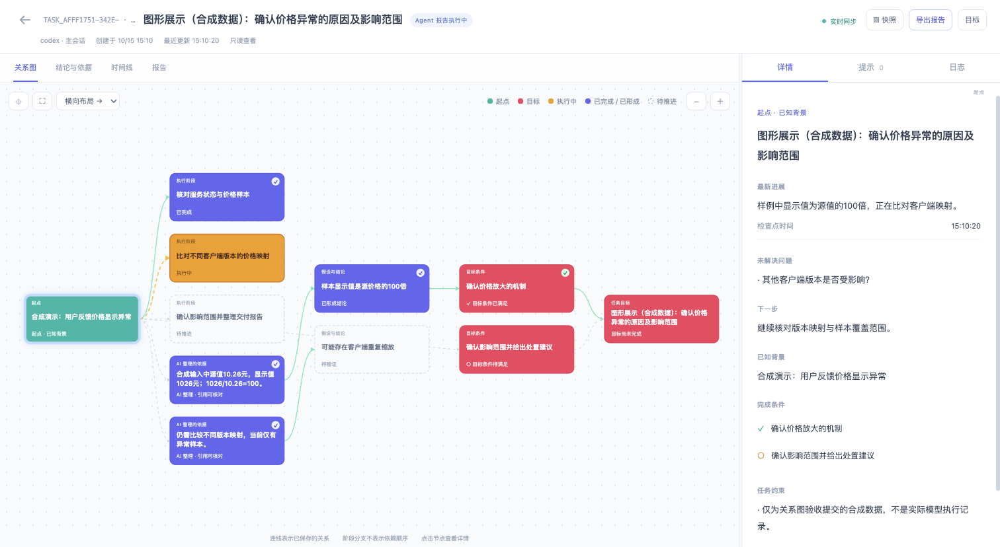

# Cairn

[English](README.md) | 简体中文

**为 Pi、Claude Code、Codex 保留目标、证据链和可恢复的进度。**

Cairn 3.0 将模型操作收敛为五个工具：**开始、恢复、读取、阶段记录、结束**。普通任务默认使用 `curated` 模式：AI 自主调用宿主已有工具，只在有价值的阶段保存进度、结论、整理后的依据和文件／链接引用，**Cairn 不记录这些工具调用及原始结果**。

模型、账号、会话、工具审批和并发由原有 CLI 管理。Cairn 使用 TypeScript 与 SQLite 保存目标记录，并提供蓝白进度看板。普通任务无需配置工具白名单或 MCP 上游。

## 快速开始

需要 **Node.js 24 或更新版本**。先在 Cairn 仓库根目录安装全局命令：

```sh
npm install
npm run install:global
cairn --version
```

脚本构建、打包并安装一份独立的全局副本，不向 npm registry 发布包。安装后可在任意项目目录执行 `cairn`，无需输入 `node bin/cairn.mjs`，也不依赖当前终端位于源码目录。

如果 npm 默认全局目录不可写，可选择用户目录：

```sh
npm run install:global -- --prefix "$HOME/.local"
export PATH="$HOME/.local/bin:$PATH"
cairn --version
```

脚本还支持 `--cache DIR` 和 `--offline`；离线安装要求仓库依赖已准备好。

进入要使用 Cairn 的项目，按实际使用的宿主选择安装命令。目标 CLI 需要已安装并配置模型或账号。

```sh
cd /path/to/your-project

# 按实际使用的宿主选择；默认安装到当前项目。
cairn install --target pi
cairn install --target claude
cairn install --target codex
cairn ui
```

安装后开启新的 CLI 会话。Codex 需要信任项目，并通过 `/hooks` 检查和信任 Cairn hooks。跨项目使用可增加 `--scope user`；`--root DIR` 可指定安装根目录。

直接把目标和工具使用说明交给 Agent：

> 使用 Cairn 排查这个接口为什么超时。可用日志和指标工具的说明如下，请自行选择最有价值的查询。形成阶段结论时保存依据、文件或链接引用，以及正在执行、已完成和阻塞的工作。完成条件是说明影响面、原因和解决建议；证据不足就保存缺口并暂停。不需要保存工具调用记录。

工具说明属于初始任务输入，可放入 `goal`／`constraints`；框架不预先写死 AI 必须调用哪些工具。工具能否执行仍遵守宿主自身的授权和权限。

[通用目标工作流完整指南](docs/goal-workflow.zh-CN.md) 提供不配置工具、不保存调用日志的完整样例，并解释进度、预算、子 Agent 和原始观测的职责。

## 模型的最短使用流程

### 开始 → 自由使用工具 → 完成验收

以下是 **Cairn 工具调用参数**，由 Agent 在宿主中执行。Claude Code／Codex 的 MCP 连接首次调用 `cairn_start` 或 `cairn_resume` 时，使用启动 hook 提供的真实 `session_id`；Pi 自动绑定原生会话，省略该字段。后续无需重复传会话或任务 ID。

**1. `cairn_start`：** 只给目标即可，未提供 `criteria` 时，目标本身成为唯一完成条件 `c1`。

```json
{
  "session_id": "HOST_SESSION_ID_FROM_STARTUP",
  "goal": "确认 package.json 中的项目名称"
}
```

**2. Agent 使用宿主已有工具读取 `package.json`。** 默认不保存读取的工具名、参数和结果，不生成 `E1` 等原始取证编号。

**3. `cairn_finish`：** 一次写入整理后的结论并检查完成条件。

```json
{
  "summary": "已确认项目名称为 cairn。",
  "findings": [{
    "key": "project-name",
    "text": "package.json 的 name 字段为 cairn。",
    "status": "supported",
    "basis": "读取项目清单，核对 name 字段。",
    "references": ["package.json"]
  }]
}
```

单一完成条件会自动关联新增的已支持结论；多个条件用 `covers: ["c1", "c2"]` 关联。未满足条件时保持 `active`，返回 `phase: "incomplete"` 和缺口。程序检查记录格式、结论状态和覆盖关系，**不会自动打开引用验证内容，也不能替 AI 判断因果是否成立**。

### 长任务：保存依据和可见的执行进度

形成阶段结论、改变方向或需要交接时，用 `cairn_checkpoint` 保存同样的 finding 内容，再带上 `questions`、`next` 和可选执行项：

```json
{
  "summary": "已检查配置，正在核对超时窗口。",
  "progress": [
    {"key":"config","title":"检查配置","status":"completed"},
    {"key":"window","title":"核对超时窗口","status":"running"}
  ],
  "questions": ["连接持有时间是否异常？"],
  "next": "核对连接占用与慢查询时间窗口。"
}
```

- `key` 是可读标识，复用它会修订同一结论或进度项。
- `basis` 保存 AI 整理的支撑理由；`references` 保存文件路径、链接等来源。已支持结论需要依据或引用，建议同时提供。
- `status` 用 `proposed`、`supported`、`refuted`、`inconclusive` 表示结论状态；不要把未验证假设标成已支持。
- `progress.status` 用 `pending`、`running`、`completed`、`blocked`、`cancelled` 表示工作状态。它与目标是否通过验收分别保存。
- `questions` 是未解决问题，`next` 是下一步。无需登记每次思考或每个工具调用。

阶段记录的 `summary` 描述当前进展，不覆盖已有最终报告摘要；结束时明确传入 `summary` 或 `report.summary` 设置最终报告。简单任务可直接 finish，无需先 checkpoint。无新增内容地重试已完成的 finish，会返回已有状态。

| 五个固定工具 | 用途 |
| --- | --- |
| `cairn_start` | 创建目标、完成条件、初始约束和可选进度 |
| `cairn_resume` | 恢复或显式接管任务，绑定当前连接 |
| `cairn_read` | 读取摘要、整理依据与引用、完整任务或分页历史 |
| `cairn_checkpoint` | 一次保存结论、进度、目标覆盖、问题和下一步 |
| `cairn_finish` | 一次保存并验收完成，或保存缺口后暂停 |

## 预算如何配置

**普通任务默认不配置次数和并发预算，以完成目标为结果。** 省略 `budget` 即可；并发由宿主安排，模型与账号额度由宿主管理。

| 情况 | 行为 |
| --- | --- |
| 普通 `curated`，不传预算 | 没有 Cairn 调用次数／并发配额 |
| 普通 `curated`，传 `budget.deadline` | 时间目标，仅提醒；到期可继续，不自动完成 |
| 普通 `curated`，传 `maxCalls`／`maxParallel` | 拒绝配置：不统计调用，就不能宣称执行硬限制 |
| 显式 `captured` | 可限制网关调用和实际经过 hook 的原生调用；不能保证覆盖宿主所有工具路径 |
| `emergency` 比赛 | 保留共享 30 分钟截止时间及提交预留窗口 |

工具次数、到期或预算耗尽都不代表成功。确实需要停止时保存未满足条件和下一步，标记暂停；之后恢复继续。原演示的六次调用上限只是该样例配置，不是通用默认值。

## 蓝白关系图

```sh
cairn ui
cairn ui --port 8001
cairn ui --db .cairn/state.db --port 8001
```

Multica 等环境使用固定数据库时，只需首次保存一次，以后在任意目录运行 `cairn ui`：

```sh
cairn ui --db /path/to/multica/state.db --remember
# 以后直接启动
cairn ui
# 清除保存的看板配置并退出
cairn ui --forget
```

看板数据库优先级为 `--db` → `CAIRN_DB` → 已保存的看板 → 当前工作区。该设置用于 UI；MCP、hooks 和任务命令继续按各自的参数与环境配置运行。设置保存在用户目录的 `.cairn/ui.json`，`CAIRN_CONFIG_HOME` 可指定配置根目录。

浏览器打开终端打印的地址。不指定 `--port` 时先尝试 `8000`，被占用则自动选择可用端口；显式指定端口时按指定值启动。**关系图是默认主视图，不再提供独立任务进度看板。** 起点、阶段、依据、结论、完成条件和目标在图中展示；点选节点查看右侧详情。保留缩放、平移、适应画布、全屏和横纵布局。时间线展示目标创建、进展、暂停、恢复、检查和完成等关键事件，正文按需展开。

沿用旧版配色：**起点青绿、目标玫红、已完成节点紫蓝、执行中橙黄、待执行浅色虚线**。节点同时写明角色和状态；目标满足后保留目标色，以状态标记和完成连线表达完成。已保存的阶段是独立执行分支，依据与结论之间的连线使用实际登记关系，不把阶段顺序当成业务因果。



看板展示的是**最近记录的执行状态**。`active` 只表示目标仍可继续，不能证明 Agent 进程实时存活；普通模式也不会用“零次工具调用”推断没有在执行。三种 CLI 的 curated 任务均由 Agent 用 checkpoint 的统一 `progress` 保存并恢复工作状态。

没有可靠原任务关联的宿主计划事件会跳过，避免迟到结果写进另一个目标。仅 captured Codex 在已有调用保留正确任务／执行代次关联时，才可映射成功的 `update_plan` 结果；Claude／Pi 不保证同步内部计划。普通模式不为此新增工具关联记录。

界面只读且只监听本机回环地址。Agent 继续在原 CLI 工作；关闭看板不会停止任务。目标覆盖率可以随结论修订而下降。空白时检查看板和 CLI 是否使用同一数据库与工作区。

```sh
cairn task list
cairn task show TASK_ID
cairn export TASK_ID --format json --out task.json
cairn export TASK_ID --format markdown --out report.md
cairn export TASK_ID --format html --out evidence.html
```

将 `TASK_ID` 替换为实际值。普通任务导出 AI 整理的依据与引用，captured 任务可包含原始结果。

## 暂停、恢复和子 Agent

先 checkpoint 保存进展，再调用 `cairn_finish`：

```json
{"outcome":"suspended"}
```

新会话或跨 CLI 恢复时调用 `cairn_resume`：

```json
{
  "session_id": "NEW_HOST_SESSION_ID_FROM_STARTUP",
  "task_id": "TASK_ID",
  "takeover": true
}
```

接管递增执行代次，旧会话不能再修改或完成该目标。暂停时正在执行的进度项变为阻塞；恢复后按实际情况显式更新为执行中。恢复包含目标、依据、引用、进度和未解决问题，原生聊天历史仍由宿主保存。

**子 Agent 适合独立子任务或需要新上下文的检查。** 主 Agent 汇总并审阅子任务结果，再保存主目标的阶段记录。子 Agent 的新上下文不会自动获得主目标身份或写权限；持久交接到另一原生会话时，仍需要 Adapter 的显式 resume／takeover。无需建立新的 worker 池或固定 reason／explore 交接流程。

恢复摘要控制在 **16 KiB 以内**，带总量和截断标记；持久记录不随摘要截断而删除。`cairn_read` 的 evidence 视图按结论 key／ID 读取整理依据，details 读取完整任务，history 读取事件历史。分页与完整恢复格式见 [架构说明](docs/architecture.md#persistence-and-compact-restoration)。

用户中断优先，暂停后没有续跑提示；完成检查的补充提示有次数上限。

## 三种 CLI 的适配

| 宿主 | 安装形态 | 进度与恢复 |
| --- | --- | --- |
| Pi | 自包含原生 package、扩展和共享 skill | 自动绑定原生会话；状态变更／压缩后恢复摘要；checkpoint 保存进度 |
| Claude Code | 本地 marketplace 插件，含 skills、hooks、stdio MCP | 首次 start／resume 使用启动 hook 的真实 ID；checkpoint 保存进度 |
| Codex | 项目／用户 hooks、MCP、skill；同时构建 marketplace 包 | 同样绑定身份；checkpoint 保存进度；captured 计划事件需可靠任务／代次关联 |

构建产物位于 `dist/plugins/{pi,claude,codex}`，每包包含自己的运行时。Codex 项目级安装使用原生配置登记，不依赖全局插件缓存自动激活。

其他 MCP 客户端可运行共享服务并加载 `skills/cairn`：

```sh
cairn mcp --host mcp --session-id my-task-session
cairn doctor --target codex
```

仅 MCP 即可显式记录普通任务和恢复状态。原生生命周期与压缩上下文接入取决于宿主实际提供的事件。`doctor` 区分声明能力和已观察到的事件，检查版本、安装、MCP、已配置上游与 hooks 启动观察状态。缺少取证 hooks 不影响 curated 任务；缺少恢复事件时使用显式 read／resume。严格比赛任务缺少要求的能力时拒绝启动或接管。

## 可选原始取证：captured 与演示

需要原始工具证据时，新建任务明确选择 `evidence_mode: "captured"`。这时 `Observation` 表示一份**原始观测／取证依据**，保存工具输入、结果、来源、范围与执行身份；它不是 Agent 角色。`E1` 等只是当前任务的原始观测编号。结论通过 `evidence`／`against` 引用支持与反证。

默认 curated 不创建 Observation，使用 `basis`／`references` 保留 AI 整理的依据链。两类信息有不同的来源保障，界面与报告会区分；人工提示也保留人工来源。

原完整演示继续保留，**明确使用 captured 模式**：

```sh
cairn demo
cairn demo --port 0
cairn demo --no-ui --delay 0 --json
```

它创建隔离的临时工作区，以本地模拟价格异常数据和固定 driver 执行真实 stdio MCP：取证 → 阶段记录 → 暂停 → 新会话接管 → 补查 → 完成与导出。无需模型账号；其配置的工具白名单和六次调用预算不适用于普通任务。终端打印看板地址，完成后保持前台，Ctrl+C 关闭。

要交给真实模型，准备新的样例工作区：

```sh
unset CAIRN_WORKSPACE
cairn demo --prepare --target codex --root ./cairn-example
cd cairn-example
export CAIRN_DB="$PWD/.cairn/state.db"
codex
```

让 Agent 读取 `PROMPT.md`；可把 `--target codex` 改为 `pi`／`claude` 并启动对应 CLI。另开终端进入同一目录，执行 `cairn ui --db "$PWD/.cairn/state.db" --port 0`。准备命令不启动模型，账号、审批和调用额度来自宿主。

非空目标目录不会被覆盖。`CAIRN_DB` 只在样例终端设置，避免样例在其他 Git 仓库内时使用父项目数据库；其他工作请开新终端，或执行 `unset CAIRN_DB`。原取证专用链路见 [价格异常完整样例](docs/examples/price-incident.zh-CN.md)，历史真实模型／CLI 验证另见 [验证记录](docs/verification.md)。

## 应急比赛 Profile

普通任务无需此配置。比赛场景先复制仓库中的 [比赛配置模板](profiles/emergency.example.json)，填写主办方正式定义；随后在目标项目指定完成后的配置文件：

```sh
cairn configure --file /absolute/path/to/official-tools.json
```

模板尚未配置主办方实际工具。比赛要求 `captured`、原生接入、受控网关以及本队／本关／问题／比赛范围。保留跨关卡持久化的 **30 分钟比赛截止时间**、默认最后 30 秒提交预留、真实当关 `result_ref`、影响面、根因层级、止损／修复／预防。人工提示和历史手工观测不能充当比赛证据。

网关按原参数 Schema 暴露 `cairn_tool_<配置名>`，支持 stdio／Streamable HTTP、连接复用与独立请求取消。普通 curated 如已配置只读上游，可无记录透传；submit／receipt 必须走 captured 的交付校验，不能跳过回执保护。普通模式下这些配置不限制 AI 调用宿主其他工具。

比赛 finish 校验通过后停留在 `ready_for_delivery`；配置的提交工具注入已校验报告并保存真实回执。回执不明先查询核对，不盲目重提。随后等待人工确认：

```sh
cairn confirm TASK_ID
```

Agent 再调用 `cairn_finish {}` 完成。本地校验保证引用结构和范围，主办方负责最终归属、评分与接受结果。

## 更新、卸载与数据

```sh
# 在 Cairn 仓库更新全局命令。
npm install
npm run install:global

# 回到原目标项目更新实际使用的适配包。
cd /path/to/your-project
cairn update --target codex
cairn uninstall --target codex
```

全局命令与宿主适配包独立安装，更新全局命令不会替换已安装的适配副本。沿用原 scope／root，并重启宿主会话。安装器合并配置并记录自身条目，卸载时保留被用户修改的登记项及所需运行时。任务数据单独保留。删除全局命令可执行 `npm uninstall --global cairn`，自定义 prefix 时带回相同 `--prefix DIR`。

数据库默认 `<workspace>/.cairn/state.db`；`CAIRN_DB`／`--db` 可覆盖，`CAIRN_WORKSPACE` 可选择工作区。已有 TypeScript SQLite 任务保持原语义：没有 `evidenceMode` 字段的历史任务仍按 captured 解释，不会自动转换。新 public general 任务才默认 curated。早期 Python 数据格式不自动迁移，请勿把任务数据提交到 Git。

Bootstrap 保留“在当前会话先直接尝试解决”的策略：理解目标与约束、执行有价值的行动、复核并修正。无需单独 bootstrap worker、保活提示、模型池、轮询 dispatcher 或固定 reason／explore 流程。

## 开发与验证

```sh
npm test
npm pack --dry-run
node scripts/host-smoke.mjs pi
node scripts/host-smoke.mjs claude
node scripts/host-smoke.mjs codex
node scripts/pi-fixture-smoke.mjs
node scripts/claude-fixture-smoke.mjs
```

`npm test` 包括类型检查、构建和确定性测试，不调用真实模型。真实宿主 smoke 使用已配置账号，可能消耗额度；Pi／Claude 协议 fixture 使用本地模型 API 服务，只验证接入链路，不代表真实模型推理效果。

实际测试结果与历史模型运行分别记录于 [验证说明](docs/verification.md)。架构边界见 [architecture](docs/architecture.md)，诊断准确率和任务质量需通过 [评测案例与量表](evaluations/README.md) 另行验证。

## 背景与许可

Cairn 最初是一个以目标为导向的探索引擎，曾在腾讯云 AI 渗透测试挑战赛验证。当前版本将目标、证据和人工提示思想融入通用 CLI 插件。

项目采用 [AGPL-3.0](LICENSE) 许可证。
