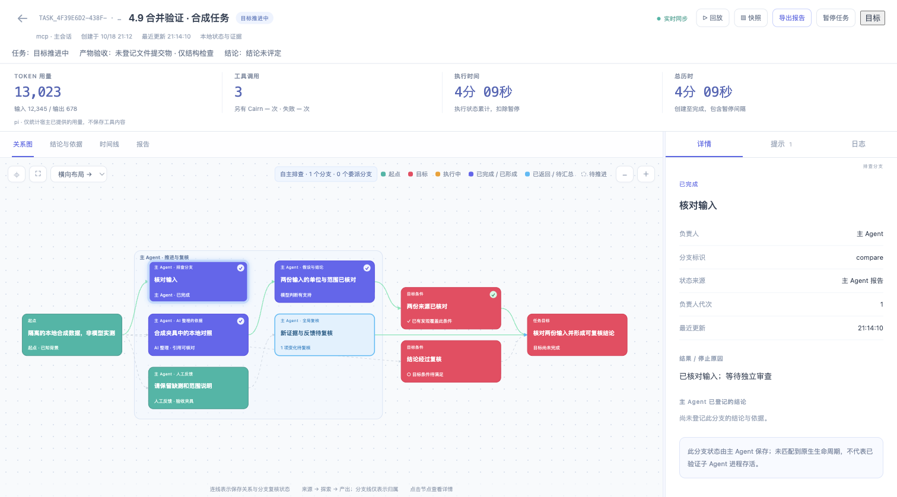

# Cairn 文档导航

当前代码版本为 **4.9.0**。Cairn 是通用的目标、证据与恢复框架，嵌入 Pi、Claude Code、Codex 或任意 MCP 宿主；修复代码、核对数据、研究和排障均可使用。模型、账号、业务工具和审批由宿主提供。

## 当前使用指南

| 需求 | 文档 |
| --- | --- |
| 安装、更新、命令与宿主接入 | [中文 README](../README.zh-CN.md)、[English README](../README.md) |
| 一个实际目标如何开始、更新、暂停、接管和完成 | [目标工作流](goal-workflow.zh-CN.md)、[实际任务提示词](examples/actual-agent-prompts.zh-CN.md) |
| 四种 CLI 的接入状态与本轮验证边界 | [CLI 适配检查](cli-adaptation.zh-CN.md) |
| 自定义 MCP 宿主和 TypeScript SDK | [Harness 集成](harness.zh-CN.md) |
| 自动 Bootstrap／Reason／Explore、会话策略与启动方式 | [可选调度层](scheduler.zh-CN.md) |
| 文件验收、分层交接、验证器 | [产物与交接](artifacts-handoffs.zh-CN.md) |
| 宿主自主分支与即时状态 | [分支协议](../skills/cairn/references/delegation.md)、[即时更新示例](examples/immediate-state.zh-CN.md) |
| 完整图、分页、快照和增量 | [图上下文协议](../skills/cairn/references/graph-context.md) |
| 来源版本、全局复核、人工反馈和重开 | [探索协议](../skills/cairn/references/exploration.md)、[示例](examples/exploration-feedback.zh-CN.md) |
| Multica 与 cc-switch | [Multica](multica.zh-CN.md)、[cc-switch](cc-switch-usage.zh-CN.md) |
| 代码结构和领域术语 | [架构](architecture.md)、[术语](../CONTEXT.md) |
| 本次合并边界和检查 | [4.9 合并说明](integration-4.9.zh-CN.md)、[验证记录](verification.md) |

## 运行模式与默认值

- **宿主工具循环**：六工具 `start / resume / read / update / checkpoint / finish`，默认 `curated`。`update` 即时保存单项变化，`checkpoint` 保存增量与交接，模型 `finish` 仅接收 `outcome` 和可选短摘要。SDK `invoke` 保留旧宽接口，模型接入使用 `invokeModel`。
- **可选自动调度**：`cairn submit` 只保存目标，`cairn run` 或 SDK `Scheduler` 才执行阶段。支持 Pi/Codex，新任务默认 `session-mode single`、`start-mode auto`，同一原生会话顺序执行。显式 `session-mode multi` 才创建独立 Explore，默认 `fresh-full`、探索并发 1；按需设置并发。auto 有已存工作或待审反馈时选择 Reason-first，否则 Bootstrap-first；不额外询问模型，也不按题型猜测。
- **显式 captured**：额外保存原始观测与 E#，适用于需要受控取证的任务；不会自动转换历史记录。
- 默认不设任务时间、token、调用或阶段预算。宿主额度和权限依然有效；无进展、协议反复失败、无法恢复和未满足完成条件仍可暂停。

## 状态应如何理解

任务完成、产物契约验收、独立结论正确性、宿主执行状态分别呈现。`supported` 是模型登记的判断，验收通过只证明实际检查范围，不能据此推导结论正确。分支执行返回后仍需负责人复核；来源版本变化时，确认全局复核不能替代重新核验。

图回放使用保存的自然时间。数字用量只累计宿主已提供的值；缺失显示 `—`，缓存包含在输入，推理属于输出。自动调度各阶段用量与原生主会话 hooks 分别标明来源，不把历史缺测填成零。

## 当前看板

下图为 4.9 的隔离合成验收数据，不是模型基准结果。

## 历史实验与设计记录

[实验索引](../evaluations/README.md) 汇总各轮协议、模型对比和局限。[优化路线图](optimization-roadmap.zh-CN.md)、`optimization-round*.md`、OpenRig 比较及旧 UI 截图保留当轮含义，不是当前安装指南。

最新的[多分支实验](../evaluations/multibranch/comparison.zh-CN.md)使用冻结的 4.9.0，比较 Pi + DeepSeek 的单会话与强制独立 Explore；它早于当前默认会话策略变更，不能作为变更后的复测。[第十五轮](../evaluations/public-rca/comparison-round15.zh-CN.md)保留旧 3.1 代码的历史含义。本次仅运行本地确定性回归与 UI 验证，不追加模型费用。比赛专用 profile、delivery/confirm 和固定排障报告字段已从当前公共接口移除；历史记录保留原貌。
