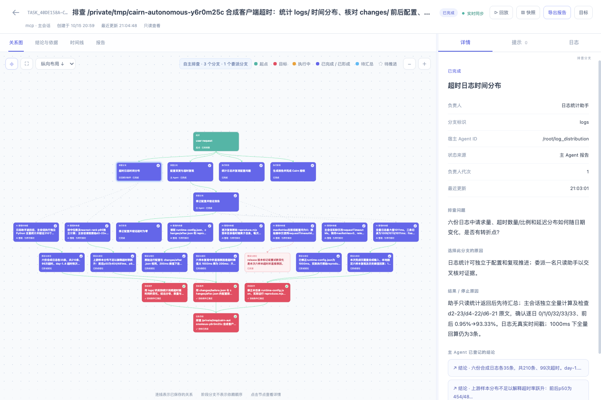

# 自主分支排障：日志助手与主会话协作

这个练习使用合成日志、配置变更和可执行复现，不访问线上系统。主 Agent 自己决定分支与助手数量。下面的材料与 2026-10-15 本机 Codex 验证所用输入一致。

## 1. 创建隔离练习目录

在终端执行；需要 Python 3、Node.js 24+ 和已安装的 `cairn` 命令：

```sh
example_dir=$(mktemp -d /tmp/cairn-autonomous.XXXXXX)
python3 - "$example_dir" <<'PY'
import json, sys
from pathlib import Path
root = Path(sys.argv[1])
(root / 'logs').mkdir()
(root / 'changes').mkdir()
for day in range(1, 7):
    rows = []
    for i in range(35):
        latency = 120 + (i * 37 + day * 19) % 900
        timeout = 200 if day >= 4 else 1000
        rows.append({'request': f'd{day}-{i}', 'upstreamMs': latency,
                     'timeoutMs': timeout, 'clientTimedOut': latency > timeout})
    (root / 'logs' / f'day-{day}.json').write_text(json.dumps(rows, indent=2))
before = {'requestTimeoutMs': 1000, 'maxRetries': 0, 'release': '1.0'}
after = {'requestTimeoutMs': 200, 'maxRetries': 0, 'release': '1.1'}
for name, value in [('before', before), ('after', after)]:
    (root / 'changes' / f'{name}.json').write_text(json.dumps(value, indent=2))
(root / 'runtime-config.json').write_text(json.dumps(after, indent=2))
(root / 'reproduce.mjs').write_text("""import {readFileSync} from 'node:fs';
const config=JSON.parse(readFileSync(new URL('./runtime-config.json',import.meta.url)));
const sampleUpstreamMs=[120,180,250,500,800,950];
console.log(JSON.stringify({synthetic:true,timeoutMs:config.requestTimeoutMs,
sampleUpstreamMs,timeouts:sampleUpstreamMs.filter(t=>t>config.requestTimeoutMs).length}));
""")
print(root)
PY
cd "$example_dir"
cairn install --target codex
codex
```

按宿主要求信任项目与插件。Claude／Pi 使用各自安装目标和启动命令；Pi 需要环境本身具有委派扩展。也可以在已接入 Cairn 的 Multica 排障助手里提供这个目录的绝对路径。

## 2. 把目标交给 AI

将目录实际路径替换进去：

> 使用 Cairn 排查【绝对目录】的合成客户端超时。核对 logs/ 的分布、changes/ 的配置前后对照，并实际运行 reproduce.mjs。自主判断是否调用宿主子 Agent 以及数量；有并行价值时允许委派，只读助手返回依据，由你复核汇总。
>
> 完成条件：实际统计超时变化；用配置与复现解释原因；只在练习目录修正 runtime-config.json，让原始六样本复现超时数为零，并生成 report.md，明确合成数据及验证范围。
>
> 在关系图保存各分支的问题、负责人、状态和依据。先登记待排查，实际启动后再报告执行中；助手返回先待汇总，复核后完成。新证据出现时可增减分支。默认 curated，不记录工具调用。不得修改其他项目、访问线上系统或发送外部消息。完成后调用 cairn_finish。

Cairn 不要求模型照抄一个固定分解。任务短或宿主没有助手工具时，主会话可以自己完成全部分支。观察它实际登记的 `branches`，不能只根据一句“已并行”就认为存在真实助手。

## 3. 查看关系图和回放

原生 CLI 示例的数据库默认在该练习目录下。另开终端，使用实际绝对路径，避免已保存的 Multica 看板配置指向其他数据库：

```sh
cairn ui --db /absolute/path/to/example/.cairn/state.db
```

若使用既有 Multica 集成，运行 `cairn ui` 查看它已记住的共享数据库。

图中的分支节点会显示负责人和状态；点选后看排查问题、方向选择原因、结果与关联结论。浅蓝为待主 Agent 汇总，橙黄为执行中，紫蓝为已完成。点击 **▷ 回放**，按约 **4 分 58 秒**的真实记录跨度连续播放，也可选择倍速。五次保存分别位于约 00:00（建立方向）、00:15（主／子并行执行）、01:55（助手返回待汇总）、03:11（主 Agent 独立复核并开始修正）、04:58（最终验证完成）。两次保存之间沿用最近状态；拖到 01:00 可看到主／子仍在执行，拖到 02:00 则显示助手已返回而主会话继续推进。蓝色轮廓标出最近记录的变化，主 Agent 复核与子 Agent 执行分区展示。回放不重跑工具，也不根据批量保存时间推断操作同时发生。

## 4. 本机真实模型验证结果

本次使用 Codex CLI 0.162.0 和用户配置的 `gpt-6.1-sol`，通过仅 MCP 的自动身份接入运行以上合成任务。没有规定助手数量。

- 模型选择一名只读日志助手，主会话核对配置并运行复现。共保存“日志时间分布”“配置变更与复现”“修正配置及验证报告”三个分支，最后一项从配置分支展开。
- 助手返回后先保存 awaiting_review；主会话独立重算全部 210 条记录，并查看边界样本原文，再完成日志分支。
- 前三份日志为 1/105 超时（0.95%），后三份为 98/105（93.33%）；阈值从 1000ms 降到 200ms。日志没有真实时间戳，结论按文件编号划分。
- 实际修正运行配置为 1000ms，再运行原始复现脚本，超时从 4/6 降为 0/6。报告明确说明：历史全量样本按 1000ms 回算仍有 3/210 超时，不能声称所有场景已修复。
- 最终主目标及三个分支均完成；数据库包含五条状态记录及五个回放帧，工具调用和原始观测均为零。验证进程退出码为 0，随后又实际重跑脚本确认超时数为 0。

这是合成练习的一次模型选择，不是固定策略或生产排障结论。此次通过 MCP 保存的是主 Agent 报告的分支状态；Codex／Claude 原生生命周期的匹配、乱序、暂停、接管隔离另外由适配测试覆盖。该验证不声称三种 CLI 都进行了真实模型的原生 hooks 端到端测试。


