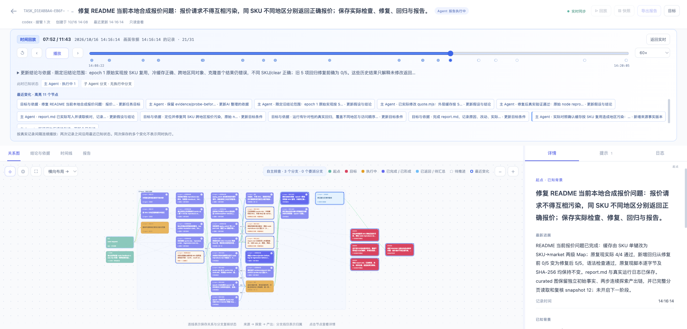

# 真实 Codex：探索链、人工反馈与任务重开

适用于 Cairn 4.7。下列业务是可修改的本地合成报价 fixture，不是生产服务。模型实际读取、改动代码并执行检查；Cairn 保存语义关系与来源引用，calls／observations 始终为空。

## 自己运行

先将仓库中的故障样例复制到新目录，只复制初始报价与原复现，第二阶段再加入反馈检查：

```sh
mkdir -p /tmp/my-cairn-exploration
cp docs/examples/exploration-feedback/quote.mjs /tmp/my-cairn-exploration/
cp docs/examples/exploration-feedback/reproduce.mjs /tmp/my-cairn-exploration/
cd /tmp/my-cairn-exploration
cairn install --target codex
codex
```

在 Codex 中输入：

> 使用 Cairn 修复本地报价请求互相污染的问题。先实际运行 reproduce.mjs；把复现和源码事实保存为中间 finding（covers=[]），用 branch.from 发起探索、finding.producedBy 保存实际产出。完成真实修复和回归，读图复核后结束目标。自主决定是否使用子 Agent，保留依据和引用，不记录工具调用。

查看看板需使用这个目录的数据库，可在另一终端运行：

```sh
cairn ui --db /tmp/my-cairn-exploration/.cairn/state.db
```

首次完成后，在仓库根目录另开终端，复制反馈检查并实际运行。复现失败后，使用真实 task_id 追加明确署名的反馈：

```sh
cp docs/examples/exploration-feedback/feedback-case.mjs /tmp/my-cairn-exploration/
cd /tmp/my-cairn-exploration
node feedback-case.mjs
cairn feedback TASK_ID --text '调用者修改返回对象后，后续报价被污染；请复核修复。' --author '样例验收者' --key caller-mutation
```

在新的 Codex 会话中明确要求继续原目标：

> 读取 TASK_ID 的完整图和已追加的反馈。使用 cairn_resume，设置 takeover=true、reopen={reason:"根据外部反馈重新验证并修复调用者对象污染"}。实际复现新失败，保留首次完成与原检查，修订解释范围；处理来源修订引起的下游待验证项。使用 from／producedBy 记录续查，重跑新旧检查，再按所读 snapshot 复核并完成同一目标。

反馈不会自动重开任务，也不会自动成为已确认事实。旧完成快照始终可回放；当前图会显示新反馈、来源版本、待验证结论与新探索。单独确认全局 review 不能跳过失效来源的重新验证。

## 本次真实运行

- 模型：本机 Codex CLI，配置的 gpt-6.1-sol／xhigh，两个独立主会话，使用原生 Cairn 接入和 workspace-write 沙箱。
- 任务：task_d1eabba4-eb6f-464b-987d-388ef3756a11。
- 首轮原复现：4 项中 2 项失败 → 4 项全部通过。新增 5 项回归：修复前全部失败 → 修复后全部通过。
- 首次完成保存在快照 14。独立验收者随后实际复现返回对象被修改后污染下一次报价，署名反馈保存在另一条事件；任务保持 completed，直到新会话显式重开至 epoch 2。
- 第二轮根据新证据收窄原解释后，三个旧下游结论实际被标为待重新验证。这不是重演时推算或人工补造的状态。
- 第二轮修复每次返回独立对象后，原复现 4/4、原回归 5/5、外部反馈用例及新增 6 项修改场景回归全部通过；独立终端再次运行均通过，三份既有检查逐字节未变。
- 最终同一目标在 epoch 2 完成，31 条事件／31 帧历史，跨度 703,826 ms。首次完成快照的 SHA-256 未变；最终无待复核或失效来源，calls／observations 均为零。两个主会话均选择了零子 Agent，图中的三个分支由主 Agent 执行。

原样发送的应用层任务输入见[首轮提示词](prompts/exploration-stage1.actual.zh-CN.txt)和[续查提示词](prompts/exploration-stage2.actual.zh-CN.txt)。它们不包含宿主系统指令、私有推理或凭据；示例中固定的 task_id 仅标识这次真实运行。

这次运行的两个主会话均可自主选择是否委派；是否存在助手执行以实际记录为准，不能由分支数量推断。业务检查只针对合成输入，不代表生产环境或任意并发场景的验证。

## 回放中的来源修订

下图是本次真实任务第 21 帧：旧来源版本被保留，三个下游结论等待重新验证。来源／产出连线与分支归属分别显示。安装后的看板按 60× 自然时间完整播放至第 31/31 帧；回放只读取历史，不执行业务操作。


