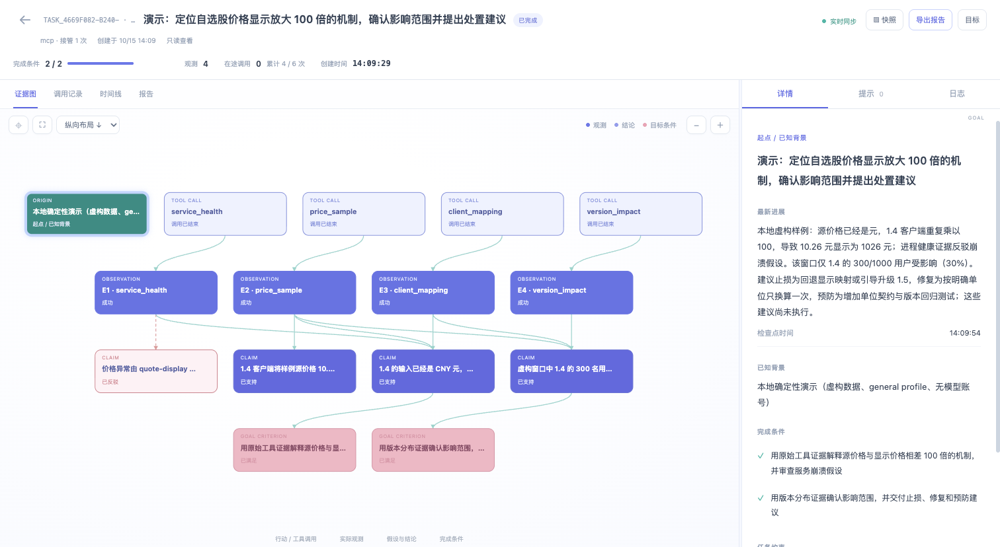

# 完整样例：价格显示异常的诊断、暂停与恢复

这个样例展示 Cairn 的完整链路：**目标 → 工具原始结果 → 证据别名 → 结论与反证 → 阶段记录 → 暂停 → 新会话接管 → 完成校验 → 报告导出**。

数据是明确标记的本地虚构数据，使用显式 `captured` 模式。价格、用户数和 `demo:` 引用都不属于真实生产系统。演示工具通过真正的 stdio MCP 进程返回结果，由 Cairn Gateway 自动采证；默认演示中的操作顺序和结论由固定脚本提供，不请求模型账号，也不验证模型推理能力。




## 1. 安装全局命令

需要 Node.js 24 或更新版本。在 Cairn 仓库根目录执行一次：

```sh
npm install
npm run install:global
cairn --version
```

安装脚本会构建、打包并全局安装独立副本，之后可离开源码目录使用。当前流程从仓库安装，不要求 Cairn 已发布到 npm registry。

如果 npm 全局目录不可写：

```sh
npm run install:global -- --prefix "$HOME/.local"
export PATH="$HOME/.local/bin:$PATH"
cairn --version
```

如需自定义缓存或离线安装，使用 `npm run install:global -- --cache DIR --offline`；离线构建要求仓库依赖已准备好。将安装器打印的命令目录加入终端 PATH，开启新终端后仍需保留对应设置。

## 2. 一条命令观看完整执行

```sh
cairn demo
```

终端打印独立临时工作区和看板地址。用浏览器打开地址，观察工具、结论与进度逐步出现。演示完成后看板仍在前台，按 Ctrl+C 关闭；生成的数据和导出文件保留。

可选运行方式：

```sh
# 操作系统分配空闲端口，避免与已有看板冲突
cairn demo --port 0

# 在一个新的指定目录运行；该目录必须不存在或为空
cairn demo --root ./cairn-demo-run --port 0

# 无界面快速执行，输出 JSON 结果与产物路径后退出
cairn demo --no-ui --delay 0 --json
```

`--delay` 的单位是毫秒，控制演示步骤间隔。每次默认使用新临时目录；指定非空目录时拒绝覆盖。样例使用自己的 `.cairn/state.db`，不会把诊断记录写入当前项目的任务库。中途 Ctrl+C 会关闭演示连接和看板，保留已采证据；未完成任务会尽力保存为暂停状态。

完成后的主要产物如下，以终端打印的实际路径为准：

| 文件 | 内容 |
| --- | --- |
| `.cairn/state.db` | 目标、原始观测、结论、检查点、负责人及审计事件 |
| `scenario.json` | 明确标记 `demo: true` 的虚构场景与只读工具数据 |
| `whitelist.json` | 四个演示工具的白名单、MCP 启动命令和引用字段映射 |
| `PROMPT.md` | 可交给真实 CLI Agent 的目标与操作说明 |
| `execution.jsonl` | 固定驱动器逐步记录的 MCP 输入、返回与连接切换 |
| `report.md` | 最终摘要、影响面、根因、建议和证据引用 |
| `evidence.html` | 可离线打开的证据图和原始结果 |
| `task.json` | 完整任务快照，便于核对引用及恢复状态 |
| `demo-processes.jsonl` | 本地工具进程和调用轨迹 |

## 3. 任务是什么

目标是定位虚构客户端价格显示放大 100 倍的机制、确认影响面并提出处置建议。

| 完成条件 | 必须说明的内容 |
| --- | --- |
| `c1` | 用原始证据解释源价格与显示价格相差 100 倍的机制，并审查服务崩溃假设 |
| `c2` | 用版本分布证据确认影响范围，提出止损、修复和预防建议 |

任务约束为只使用本地只读演示工具，不访问生产系统，建议尚未执行。预算为最多 6 次受控工具调用、最多 2 个并发调用；固定演示实际串行调用 4 个取证工具。Cairn 的 start、checkpoint 等记录操作不计入这 4 次取证调用。

## 4. 第一个会话：从观测到阶段记录

以下 JSON 展示 MCP 工具的调用参数及返回中的关键字段。任务 ID、观测 ID、时间等由运行时生成；读取结果以本次实际返回为准。

### 4.1 创建目标

固定驱动器建立 `demo-first-session` 的 MCP 连接后调用 `cairn_start`，主要参数是：

```json
{
  "goal": "演示：定位自选股价格显示放大 100 倍的机制，确认影响范围并提出处置建议",
  "criteria": [
    "用原始工具证据解释源价格与显示价格相差 100 倍的机制，并审查服务崩溃假设",
    "用版本分布证据确认影响范围，并交付止损、修复和预防建议"
  ],
  "scope": {
    "workspaceId": "demo-price-unit"
  },
  "budget": {
    "maxCalls": 6,
    "maxParallel": 2
  }
}
```

返回包含 `taskId`、`status: "active"`、负责人及执行代次 `owner.epoch: 1`、两个条件 `c1`／`c2`。本演示在 MCP 启动时绑定了 session ID，后续参数不需要重复填写任务和会话 ID。

### 4.2 检查服务，获得 E1 反证

调用 `cairn_tool_service_health`：

```json
{
  "service": "quote-display"
}
```

工具返回 `demo: true`、`result_ref: "demo:service-health"`、`process: "healthy"`、`crash_count: 0`。Gateway 保存原始输入和输出，返回证据别名 `E1`，同时保留原始 observation ID 与 `resultRef`。

这条证据用于反驳“进程崩溃引起价格异常”的假设。健康结果本身不能解释价格为什么不对，也不能据此把目标标记完成。

### 4.3 检查价格，获得 E2 症状证据

调用 `cairn_tool_price_sample`：

```json
{
  "symbol": "DEMO.600001",
  "version": "1.4"
}
```

返回的关键部分是：

```json
{
  "evidence": {
    "ref": "E2",
    "resultRef": "demo:price-sample-v1.4",
    "status": "success",
    "eligible": true
  },
  "result": {
    "structuredContent": {
      "demo": true,
      "result_ref": "demo:price-sample-v1.4",
      "source": {
        "value": 10.26,
        "unit": "CNY"
      },
      "display": {
        "value": 1026,
        "unit": "CNY"
      },
      "ratio": 100
    }
  }
}
```

这里省略了 observation ID、来源、MCP content 文本和其他字段。E2 证明样例里存在 100 倍差异；原因还需映射证据，影响面还需版本分布证据。

### 4.4 一次保存结论、反证和缺口

调用 `cairn_checkpoint`：

```json
{
  "summary": "本地样例源价格 10.26 元、显示 1026 元，相差 100 倍；健康工具未发现进程崩溃。需要进一步查单位映射与版本影响范围。",
  "findings": [
    {
      "key": "crash",
      "text": "价格异常由 quote-display 进程崩溃引起",
      "status": "refuted",
      "against": [
        "E1"
      ]
    },
    {
      "key": "price-ratio",
      "text": "1.4 客户端将样例源价格 10.26 元显示为 1026 元，放大 100 倍",
      "evidence": [
        "E2"
      ]
    }
  ],
  "questions": [
    "1.4 客户端是否对已经是元的价格重复换算？",
    "这次虚构窗口中哪些版本、多少用户受影响？"
  ],
  "next": "新会话显式接管后查询 client_mapping 和 version_impact；补齐目标证据后交付建议。"
}
```

这次记录保存一个被反驳的假设和一个已支持的症状结论。两项完成条件都没有 `covers` 关联，覆盖进度仍为 **0/2**；仅有价格异常现象不满足根因或影响面条件。

## 5. 暂停并关闭旧连接

调用 `cairn_finish`：

```json
{
  "outcome": "suspended"
}
```

返回 `phase: "suspended"`、`status: "suspended"`。先前的结论、两个未解决问题和下一步仍保留。驱动器随后关闭第一个 MCP 连接，结束其上游工具连接。

这一步没有补齐条件，也没有伪造“完成”。暂停允许保存未完成任务，供后续会话继续处理。

## 6. 新会话接管，再补充证据

固定驱动器创建 `demo-resumed-session` 的新 MCP 连接，调用 `cairn_resume`：

```json
{
  "task_id": "本次创建的真实任务ID",
  "takeover": true
}
```

返回同一个任务的目标、结论、E1／E2 证据入口和两个问题，执行代次增加为 `owner.epoch: 2`。旧会话不能再提交完成结果；Cairn 恢复任务状态，不复制宿主的聊天历史。若摘要不够，模型可以调用 `cairn_read {"view":"evidence","ref":"E2"}` 查看原始数据。

新会话依次取证：

| 工具 | 输入 | 关键返回 | 证据 |
| --- | --- | --- | --- |
| `cairn_tool_client_mapping` | `{"version":"1.4"}` | 输入与输出单位都是 `CNY`，实际表达式 `display_price = source_price * 100`，预期表达式 `display_price = source_price` | E3，`demo:client-mapping-v1.4` |
| `cairn_tool_version_impact` | `{"service":"quote-display"}` | 同一虚构窗口总用户 1000；1.4 的 300 人受影响；1.5 的 700 人未受影响 | E4，`demo:version-impact` |

E2 和 E3 共同支持重复单位换算的机制解释；E4 支持“这个窗口内 30% 用户受影响”的范围判断。不能将这个比例外推到任何真实系统。

## 7. 一次提交最终结论并完成

驱动器最后调用 `cairn_finish`，把最终摘要、结论、目标覆盖及报告一起写入。下面保留核心结构，文字做了缩写：

```json
{
  "summary": "本地虚构样例：1.4 对已经是元的源价格重复乘以 100；该窗口 300/1000 用户受影响。建议回退映射或升级、移除重复换算并增加单位契约与版本回归；建议尚未执行。",
  "findings": [
    {
      "key": "unit-conversion",
      "text": "输入已经是 CNY 元，1.4 代码再次乘以 100，与价格样例吻合；崩溃假设已被 E1 反驳。",
      "evidence": [
        "E1",
        "E2",
        "E3"
      ],
      "covers": [
        "c1"
      ]
    },
    {
      "key": "impact",
      "text": "虚构窗口中 1.4 的 300/1000 用户受影响；建议回退映射或升级、修复重复换算并增加回归测试，尚未执行。",
      "evidence": [
        "E2",
        "E3",
        "E4"
      ],
      "covers": [
        "c2"
      ]
    }
  ],
  "questions": [],
  "next": "演示已完成；真实环境需要实际验证修复效果。"
}
```

核心将 E# 解析为持久 observation ID，维护结论与条件的关系，并从覆盖完成条件的已支持结论生成报告引用。校验成功后返回 `phase: "completed"`、`status: "completed"`、`validation.ok: true`，覆盖进度成为 **2/2**。如果证据缺失、属于其他任务或条件未覆盖，finish 会保留 active 状态并返回缺口。

本样例展示工具原始结果与结论分离；日常默认模式只保存 AI 整理的依据与引用。

### 最终证据引用表

| 别名 | 原始 `result_ref` | 与结论／条件的关系 |
| --- | --- | --- |
| E1 | `demo:service-health` | 反驳 `crash` 假设，也支持 c1 的最终结论中对崩溃假设的审查 |
| E2 | `demo:price-sample-v1.4` | 100 倍价差；支持机制判断与 c1，和其他证据一起进入最终已支持结论 |
| E3 | `demo:client-mapping-v1.4` | 重复乘以 100；与 E2 共同支持 c1，支撑修复建议 |
| E4 | `demo:version-impact` | 版本与人数分布；支持 c2 的影响面判断 |

E# 是任务内别名，`result_ref` 是本地工具返回的虚构来源引用，它们指向本地样例来源。默认报告 citations 来自覆盖完成条件的已支持结论，最终涵盖 E1–E4。E1 同时反驳旧假设并支持最终判断中对该假设的排除；可在 HTML 证据图或 JSON 快照中检查完整关系。程序校验引用和覆盖结构，因果解释仍需审阅。

## 8. 交给真实 Pi、Claude Code 或 Codex

固定演示方便检查链路。若要观察模型如何选择工具、审查反证并恢复任务，生成另一个新目录：

```sh
unset CAIRN_WORKSPACE
cairn demo --prepare --target codex --root ./cairn-agent-example
cd cairn-agent-example
export CAIRN_DB="$PWD/.cairn/state.db"
cairn doctor --target codex
codex
```

样例目录可能在另一个 Git 仓库内部，默认工作区查找会向上找到该仓库根。因此，启动宿主前用绝对 `CAIRN_DB` 路径固定样例数据库；准备命令也会打印可直接复制的命令。仅在本次样例终端设置这个变量，不要写入全局 shell 配置。

进入 CLI 后告诉 Agent：

> 读取 PROMPT.md，使用 Cairn 完成其中的任务。先保存阶段记录并暂停，给我任务 ID；我会在新会话接管后继续。

`--prepare` 只创建场景、配置白名单并安装指定宿主的适配包，不执行固定驱动器、不自动调用模型。工具均为只读本地工具。目标也可以换成 `pi` 或 `claude`，在对应宿主启动新会话后使用同一份 `PROMPT.md`。

| 宿主 | 启动前要求 | 会话身份 |
| --- | --- | --- |
| Pi | 已安装 Pi 并配置可用模型，检查本项目的扩展和 skill 已加载 | 扩展绑定原生会话，无需模型填写 session ID |
| Claude Code | 已安装并完成认证，接受宿主要求的项目／本地插件信任，重启新会话加载插件 | 首次 start／resume 使用启动 hook 给出的真实 session ID |
| Codex | 已安装并完成认证，信任项目，通过 `/hooks` 检查与信任 Cairn hooks | 同上，首次绑定后不重复填写 |

真实模型运行可能消耗宿主账号额度。`doctor` 的 MCP 连通不代表所有原生事件都已被观察；刚安装时 `not_observed` 需要在实际开启宿主会话后再检查。本样例四个 `cairn_tool_*` 的原始结果由 Gateway 直接保存；原生工具采集则依赖各宿主实际提供并信任的事件。

Agent 暂停并给出任务 ID 后，结束旧会话，进入同一样例目录启动所选 CLI 的新会话，告诉它：

> 使用 Cairn 恢复任务 TASK_ID，明确 takeover=true。先查看已保存的结论和问题，再补齐证据、完成报告。不要重新创建同一目标。

也可以在同一目录切换到另一种 CLI：先执行 `cairn install --target pi` 或 `cairn install --target claude`，完成该宿主要求的信任并启动新会话，然后显式接管同一个 TASK_ID。新会话需要重新绑定；执行代次保护仍有效。

另一个终端进入同一样例目录，显式指定同一数据库，即可观察真实 Agent 的进展：

```sh
# 先进入上面创建的 cairn-agent-example 目录
cairn ui --db "$PWD/.cairn/state.db" --port 0
```

真实 Agent 可调整取证顺序，E# 不保证与固定演示相同，应引用实际返回值。恢复任务或换 CLI 的终端也需先进入样例目录并设置 `export CAIRN_DB="$PWD/.cairn/state.db"`。

准备模式不会预先生成报告和固定驱动器的 `execution.jsonl`。完成后在已设置上述 `CAIRN_DB` 的样例终端，根据实际任务 ID 自行导出：

```sh
cairn task list
cairn task show TASK_ID
cairn export TASK_ID --format markdown --out report.md
cairn export TASK_ID --format html --out evidence.html
cairn export TASK_ID --format json --out task.json
```

将 `TASK_ID` 替换为本次真实 ID。宿主自己的聊天记录由对应 CLI 保存。Cairn 的 task.json、看板和审计历史保存目标、观测与阶段状态；它们不是宿主完整聊天记录的替代品。


结束样例并退出宿主后，使用新终端处理其他项目，或清除本次终端的样例数据库变量：

```sh
unset CAIRN_DB
```

如果原先有自己的 `CAIRN_DB` 设置，按需恢复原值。固定驱动器 `cairn demo` 已显式传入隔离数据库，不依赖这些原生宿主环境设置。
