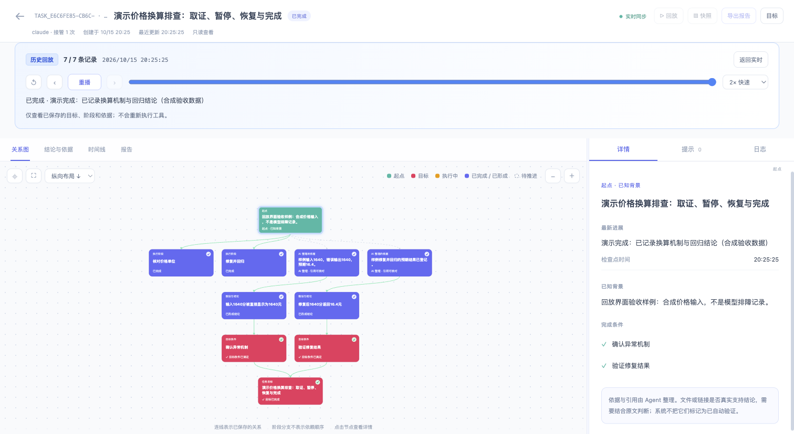

# 通用目标工作流：自由使用工具，保留依据与进度

适用于 Cairn 4.4 的默认 `curated` 模式。它不要求配置工具白名单，不保存工具名、参数或原始返回。AI 使用 Pi、Claude Code、Codex 已有的能力，在阶段节点保存目标进度、整理后的依据、结论和文件／链接引用。

本指南先回答设计问题，再给一个从初始输入到暂停、恢复和完成的完整例子。JSON 块是 **Agent 调用 Cairn 工具的参数**，不是终端命令。

## 先把实际问题交给 AI

在 Pi、Claude Code、Codex 或 Multica 中给出实际项目／输入文件路径、现象与已知材料、允许修改的范围，以及能核对的验收条件。例如：

> 使用 Cairn 修复 `/absolute/path/to/project` 中【具体功能】的失败。复现材料是【错误输出／输入文件／操作步骤】。你可以读取项目、运行本地检查并修改相关实现和测试。完成条件是原失败路径可用、相关回归通过，并说明验证范围。自行选择工具，在关键阶段保存依据、引用和下一步，最后给出实际改动及检查结果。

AI 在宿主中完成实际工作；Cairn 保存目标与证据关系。你可以在蓝白关系图中点选节点核对依据，也可以随时要求暂停，再凭 task_id 在新会话接着做。若任务只要求分析，完成条件可以是可复核的分析报告；若要求修复，建议本身不能代替实际修复和验证。

下面说明各项约定，并给出一个可以运行的本地练习。

## 1. UI 怎么看正在执行和已完成

蓝白 UI 默认打开关系图，不再提供独立的任务进度看板。沿用旧版展示逻辑，在节点和连线上区分角色与状态：

| 图中内容 | 表示什么 |
| --- | --- |
| 青绿起点 | 用户提供的问题背景与任务起点 |
| 玫红目标 | 主目标与验收条件；满足后仍保留目标角色，并标记完成状态 |
| 橙黄执行节点 | 最新记录中状态为 `running` 的工作项 |
| 紫蓝完成节点 | 已完成工作或已形成的依据／结论；具体状态以节点文字为准 |
| 浅色待推进节点 | `pending`、`blocked` 或 `cancelled` 的工作项及其说明 |
| 右侧详情 | 点选节点后查看完整内容、依据引用、状态和来源 |

阶段节点从起点展开；依据→结论→完成条件→目标的连线来自保存的关系。阶段之间不因排列顺序自动生成因果关系。图支持缩放、平移、适应画布、全屏和横纵布局，时间线和报告仍可单独查看。

Agent 可在 start／checkpoint／finish 中传 `progress`，用同一个可读 `key` 更新同一工作项。无需按每次工具调用登记。

```json
{
  "summary": "已查看配置，正在检查复现结果。",
  "progress": [
    {"key":"config","title":"查看配置","status":"completed"},
    {"key":"reproduce","title":"复现并核对结果","status":"running"},
    {"key":"report","title":"形成报告","status":"pending"}
  ]
}
```

这是 checkpoint 参数示例。支持的状态为 `pending`、`running`、`completed`、`blocked`、`cancelled`。暂停会将仍在执行的项改为阻塞；恢复后由 Agent 根据实际情况更新。

**界面显示最近记录的状态，不是进程存活探测。** `active` 意味着目标仍可推进，不能证明终端里的模型此刻正在运行。默认不采集工具遥测，因此不会用工具调用数推断忙闲。curated 进度统一通过 checkpoint 保存，不自动同步宿主计划。

没有可靠原任务关联的计划事件必须跳过，避免暂停 A、开始 B 后，A 的迟到计划改变 B。只有 captured Codex 已保存的调用关联仍符合当前任务／代次时，才会映射成功的 `update_plan`；Claude／Pi 不保证镜像内部计划。普通模式不会为了计划同步重新保存工具关联元数据。

### 按历史过程回放

回放使用**自然时间轴**。默认 1×，真实记录间隔为一分钟时，播放也推进一分钟；5×、10×、30×、60× 按同一比例加速。播放头连续移动，标记按实际时间分布，可拖到任意时刻。两次记录之间保持最近的已知状态，不按固定间隔逐帧切换。

主 Agent 与子 Agent 在图中分区，节点标明归属。子 Agent 返回时显示浅蓝“已返回／待复核”，并连接到主 Agent 的复核节点；主 Agent 接受结果后标为“复核完成”。其他方向仍可继续执行，无需等待所有助手。这些节点来自保存状态，不新增工具记录，也不推断未知操作。

蓝色外轮廓标出最近记录相对前一可还原状态的变化，点击变化标签可定位；时间戳、修订号和布局变更不会让全部节点高亮。首次显示“起始状态”；中间快照缺失时显示“累计变化”。一次保存可能包含多个变化，不能据此推断它们同时发生。

默认聚焦分支执行与复核；“适应画布”查看完整关系图，聚焦按钮回到分支视野。顶部同时显示播放时刻、已播放／总时长，以及画面所依据的记录时间。

- 点击 **▷ 回放** 从最早可还原时刻播放。可暂停、拖动、倍速、从头重播，“上一处／下一处变化”跳至相邻记录。
- 读取状态时短暂缓冲；暂停或调整速度不会被迟到请求覆盖。时间相同的记录合并到同一时刻，以最后保存的状态展示；时间缺失或倒退时保持保存顺序，并提示时间调整。
- 播放结束停在末尾，点 **返回实时** 查看最新状态；新记录不会打断历史回放。
- 回放不会重新调用工具、启动模型或接管任务；普通模式只展示保存的进展和依据，不能逐个还原未记录的工具操作。
- 4.1 之前的任务只能还原已知起点、升级时的最后状态及新增记录。缺口会明示，不根据最终结论虚构中间过程。



## 2. 预算怎么配置，什么才算完成

普通任务默认省略 `budget`。没有 Cairn 调用次数或并发配额，宿主按自己的能力决定并发，模型账号按宿主的额度工作。

需要时间目标时可设置 `budget.deadline`，填写实际的 ISO 8601 时间。普通 curated 模式中它只用于提醒，过期不会把任务标成完成，也不会拦截宿主工具。更适合把“先用约 20 分钟给出可验证结论，不能确定时保留缺口”这样的偏好写入初始约束。

curated 模式传 `maxCalls`／`maxParallel` 会报错，因为系统不统计工具调用，无法可靠执行这些硬限制。确实需要受控取证预算时，新建显式 `evidence_mode: "captured"` 的任务；其限制只覆盖网关与实际经过 hooks 的路径，不能宣称限制了宿主所有执行路径。

**完成以目标条件及其依据为准。** 工具调用多、步骤全部勾选、预算耗尽或时间到都不算完成。不能继续时保存问题和下一步，暂停后可以接着做。

## 3. 子 Agent 能替代新会话吗

**4.2 起，主 Agent 会按共享 skill 自主选择分支与助手数量。** 判断发生在当前模型会话中，实际委派使用宿主提供的工具。Cairn 保存 branches、归属与结果，仍不提供硬编码的调度器或模型 worker 池。MCP 连接身份本身不会启动模型会话，Multica 的并发任务上限也不是排查应开几个助手。

关系图现在有独立的排查分支节点：可展开子分支，并显示负责人、执行状态、结果与依据。浅蓝色表示“助手已返回，待主 Agent 汇总”；橙黄表示执行中；紫蓝表示主 Agent 已审阅完成。分支不等于已启动的助手，主会话也可以执行分支。完整参数与流程见[自主委派说明](../skills/cairn/references/delegation.md)。

建议把下面的判断交给主 Agent：

| 情况 | 如何安排 |
| --- | --- |
| 下一步明确，或后一步需要前一步的结果 | 继续当前主会话 |
| 日志、近期变更、数据核对等材料可独立检查 | 按独立问题考虑少量子 Agent；例如两个分支可各交一个助手，不是固定配额 |
| 分支之间频繁共享中间状态，或任务很短 | 留在主会话，避免反复交接 |
| 用户明确交接、切换 CLI，或主会话停止后继续 | 保存检查点，再让新原生会话显式接管 |

给助手的任务应包含具体问题、检查范围和期望返回的依据／引用。主 Agent 判断结果是否冲突或遗漏，再将核对后的结论写入主目标。不让多个助手同时接管同一个主目标。

子 Agent 适合并行核对独立问题、审阅结果，或为某个子任务提供更干净的上下文。主 Agent 审阅返回结果，再登记到同一个目标中。

完整跨会话恢复还涉及原生身份、生命周期、上下文绑定和旧负责人隔离。子 Agent 的新上下文不会自动获得主目标的写权限，也不会自动触发主目标接管。持久交接给另一个原生会话时，仍使用 `cairn_resume(task_id=实际ID,takeover=true)`。不需要另外构造模型 worker 池或固定 reason／explore 调度。

## 4. 不约束工具，还能保留证据链吗

可以。把可用工具名称、参数说明、禁止操作、优先级和完成条件作为最开始的输入；AI 在宿主中自主选择工具。Cairn 只保存有价值的整理结果：

```text
目标条件 ← 已支持结论 ← AI 整理的依据 + 文件／链接引用
```

`basis` 说明支撑或反驳理由，`references` 指向文件、链接等资料。程序核对记录是否具备依据、结论状态和目标覆盖关系，**不会自动验证引用内容或因果正确性**。只有实际查看过、能够说明来源的材料，才应该被 Agent 用来支持结论；未知和矛盾应保留为假设或未解决问题。

这也适用于只接入 MCP 的客户端：不依赖捕获任意宿主工具就能创建目标、保存阶段记录和恢复。原生生命周期恢复仍需要对应 Adapter 或显式 resume/read。

## 5. 时间线记录什么

时间线以目标创建、进展保存、暂停、接管恢复、完成检查和完成等关键节点为主，优先显示可读摘要、状态和时间；大段正文按需展开。captured 的原始取证事件可单独筛选。

默认 curated 没有工具调用日志。时间线不是 AI 每一步内部思考的流水账，也不会把原始 JSON 作为主要阅读方式。阶段 `summary` 描述当前进展，不覆盖已有报告摘要；最终 finish 的 `summary` 或 `report.summary` 明确形成报告。

## 6. Observation 是什么角色

它不是一个 Agent 或执行角色。`Observation` 是 captured 模式的一条**原始观测／取证依据**：工具输入、原始结果、来源、时间、范围与执行身份。`E1`、`E2` 是任务内原始观测的编号。

默认 curated 不创建 Observation，使用整理后的 finding、`basis` 和 `references`。历史 captured 任务仍保留原始观测，不会因为升级被删除或改成 AI 自述。人工提示继续标记人工来源。这些来源不能混同：AI 整理的文字并不自动等同于平台出具的原始结果。

## 完整样例：分析一个本地价格单位错误

### A. 准备输入和宿主

下面是明确标记的本地虚构练习，不连接生产系统。在你选定的父目录中创建新目录：

```sh
mkdir cairn-goal-example
cd cairn-goal-example
cat > price-case.json <<'JSON'
{
  "synthetic": true,
  "clientVersion": "1.4",
  "api": {"value": 1640, "unit": "cent"},
  "display": {"value": 1640, "unit": "yuan"},
  "reference": {"value": 16.4, "unit": "yuan"},
  "control": {"clientVersion": "1.5", "displayYuan": 16.4},
  "impact": {"affected": 300, "observed": 1000}
}
JSON
export CAIRN_DB="$PWD/.cairn/state.db"
```

显式数据库路径让样例即使位于其他 Git 仓库内部，也使用本目录的状态。安装你实际使用的一种适配包，例如 Codex：

```sh
cairn install --target codex
codex
```

Pi／Claude 分别改用 `cairn install --target pi`／`claude`，再启动对应 CLI。完成宿主要求的项目与插件信任步骤。另一终端进入**相同目录**，打开看板：

```sh
export CAIRN_DB="$PWD/.cairn/state.db"
cairn ui --port 0
```

打开打印的蓝白 UI 地址。此样例不执行 `cairn configure`。

### B. 最开始给 AI 的输入

可以把下面整段交给 Agent：

> 使用 Cairn 处理本地虚构练习，目标是分析 price-case.json 的价格显示错误并形成可复核结论。
>
> 完成条件：①说明单位换算错误；②计算本样本的影响比例并限定范围；③验证正确换算并提出修复建议。
>
> 可用工具由当前 CLI 提供，你可以自行读取文件、执行计算、检查结果，不需要登记工具调用，也不要求固定调用任何工具。如果使用子 Agent，只分配独立检查，由你审阅并汇总。
>
> 只操作这个练习目录，明确数据是模拟样本，不能把建议描述为已修复真实系统。使用默认 curated 模式，不设调用次数预算。结论保存依据和文件引用；生成 calculation-check.md，写明核算方法与结果。先读取输入并记录初步判断，再暂停；告诉我实际任务 ID。下一会话接管后补完计算、影响分析和最终验收。

宿主提供的可用工具说明可继续附在这段输入后。Cairn 不需要知道这些工具的固定名称或 Schema。

### C. 创建目标并展示执行项

Agent 调用 `cairn_start`，Claude／Codex 使用 hook 中实际提供的身份，Pi 省略 `session_id`：

```json
{
  "session_id": "HOST_SESSION_ID_FROM_STARTUP",
  "goal": "分析本地虚构价格单位错误并形成可复核结论",
  "criteria": [
    "说明单位换算错误",
    "计算样本影响比例并限定范围",
    "验证正确换算并提出修复建议"
  ],
  "constraints": [
    "只操作本练习目录；数据为虚构样本",
    "自行选择宿主工具，不保留调用记录",
    "生成 calculation-check.md；建议不能冒充生产修复"
  ],
  "progress": [
    {"key":"input","title":"读取输入并形成初步判断","status":"running"},
    {"key":"calculation","title":"核对换算与样本影响比例","status":"pending"},
    {"key":"report","title":"复核并形成报告","status":"pending"}
  ]
}
```

返回的完成条件标识为 `c1`、`c2`、`c3`。记录返回的实际任务 ID；下文的 `TASK_ID` 都需替换。

### D. 自主读取，保存初步依据，然后暂停

Agent 使用宿主文件工具或终端读取 JSON。Cairn 不保存这次调用，不返回 E#。根据实际读取结果保存 `cairn_checkpoint`：

```json
{
  "summary": "输入里 API 使用分，显示端直接标成元；需要核算后确认。",
  "findings": [{
    "key": "unit-conversion",
    "text": "显示端可能漏掉分到元的换算。",
    "status": "proposed",
    "basis": "模拟输入的 API 值为 1640 分，显示值却为 1640 元；参考值为 16.4 元。",
    "references": ["price-case.json"]
  }],
  "progress": [
    {"key":"input","title":"读取输入并形成初步判断","status":"completed"},
    {"key":"calculation","title":"核对换算与样本影响比例","status":"running"}
  ],
  "questions": ["换算和影响比例是否能独立核算一致？"],
  "next": "计算 1640/100 与 300/1000，将方法和结果保存为 calculation-check.md。"
}
```

此时假设未标为 supported，也未覆盖目标条件。看板可同时看到已完成的读取、执行中的核算，以及待做的报告。随后调用 `cairn_finish`：

```json
{"outcome":"suspended"}
```

看板显示暂停；核算项变为阻塞。Agent 告知实际任务 ID 后结束这个原生会话。

### E. 新会话接管并恢复

重新启动任意一种已配置 CLI，继续使用相同工作区和数据库。给新 Agent：

> 使用 Cairn 恢复任务 TASK_ID，明确接管。先检查保存的目标、初步结论、依据引用、阻塞项和下一步，再完成练习。不需要重建旧工具调用记录。

Agent 调用 `cairn_resume`：

```json
{
  "session_id": "NEW_HOST_SESSION_ID_FROM_STARTUP",
  "task_id": "TASK_ID",
  "takeover": true
}
```

接管会增加执行代次，旧会话不能再提交结果。新 Agent 根据恢复内容自行选择工具，复核文件，计算 `1640 / 100 = 16.4`、`300 / 1000 = 0.3`，并创建真实的 `calculation-check.md`。不要仅复制本指南的结论而跳过复核。

恢复执行时可用 checkpoint 将核算项更新为 `running`，报告项保持 `pending`；完成核算后再更新为 `completed`。有独立核对需要时可使用宿主子 Agent，但主任务负责人仍是当前接管会话。

### F. 完成目标验收

确认文件和核算内容后，Agent 调用 `cairn_finish`。下面内容只对应上述模拟数据，实际任务应引用实际核验结果：

```json
{
  "summary": "模拟样本存在分到元换算遗漏：1640 分应为 16.4 元；样本影响比例为 30%。核算已记录，修复建议尚未在生产执行。",
  "findings": [
    {
      "key": "unit-conversion",
      "text": "显示端未将分除以 100 换成元，展示值放大 100 倍。",
      "status": "supported",
      "basis": "API 的单位是分；1640/100=16.4，与参考值和 1.5 对照值一致。",
      "references": ["price-case.json", "calculation-check.md"],
      "covers": ["c1"]
    },
    {
      "key": "sample-impact",
      "text": "虚构观察样本中 300/1000，即 30% 受影响；不能外推全量用户。",
      "status": "supported",
      "basis": "只采用输入样本的 affected 与 observed 数量，核算 300/1000=0.3。",
      "references": ["price-case.json", "calculation-check.md"],
      "covers": ["c2"]
    },
    {
      "key": "fix-proposal",
      "text": "建议按 API 单位统一换算，并补充分/元显示回归检查。",
      "status": "supported",
      "basis": "正确换算产生 16.4 元；核算文件记录方法、结果和范围。这里只验证建议的计算，未修改生产。",
      "references": ["calculation-check.md"],
      "covers": ["c3"]
    }
  ],
  "progress": [
    {"key":"input","title":"读取输入并形成初步判断","status":"completed"},
    {"key":"calculation","title":"核对换算与样本影响比例","status":"completed"},
    {"key":"report","title":"复核并形成报告","status":"completed"}
  ],
  "questions": []
}
```

结构和条件覆盖通过后返回 `status: "completed"`。若漏了条件、没有支撑依据或结论仍是 proposed，则保持 active 并列出缺口；Agent 应补查或暂停。看板中执行项、目标完成条件与报告分别可读。

程序的通过结果表示“记录和条件覆盖符合约定”，不等于程序独立证明了文件内容和诊断真伪。Agent 和使用者仍需审阅依据是否真的支持结论。

### G. 查看和导出

在样例目录另一个终端执行，替换实际 `TASK_ID`：

```sh
cairn task show TASK_ID
cairn export TASK_ID --format markdown --out report.md
cairn export TASK_ID --format json --out task.json
cairn export TASK_ID --format html --out evidence.html
```

这些导出以当前目标状态、工作进度、结论、依据、引用和报告为主，不包含原始工具调用日志。完整暂停／恢复等事件历史保存在 SQLite；UI 时间线查看最近进展，`cairn_read` 的 `view: "history"` 可分页读取历史。不要把当前任务快照当成完整事件导出。完成其他项目工作前换新终端，或执行 `unset CAIRN_DB`。

## 与原取证样例的关系

`cairn demo` 及 [价格异常取证样例](examples/price-incident.zh-CN.md) 继续保留，用显式 captured 模式演示真实 MCP 原始结果、E#、显式预算与报告导出。它的工具配置、六次上限和历史真实模型运行属于那套样例，不是普通目标任务的前提。

两种模式都保留目标、证据链和恢复，但来源保障不同：curated 保存 AI 整理的依据与引用；captured 另保存原始观测，根据任务需求在创建时选择，历史任务不会被自动转换。
