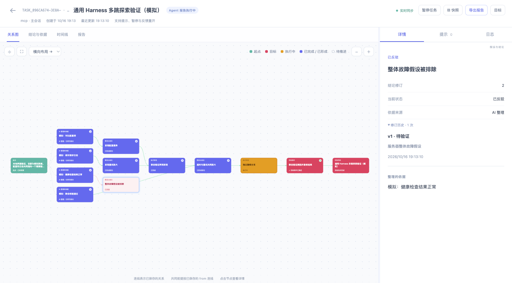

# 通用 Harness 接入与协作

Cairn 将目标、探索图、证据与协作状态保存在共享 SQLite 中。宿主负责模型、工具执行、权限、子 Agent 和进程生命周期。可以接任意支持 stdio MCP 的宿主，也可以嵌入自己的 Node.js 应用；无需 Docker、模型密钥或额外调度进程。

## 任意 MCP 宿主

先在源码目录构建并安装独立副本：

```sh
npm install
npm run install:global
```

将下面的服务条目加入宿主的 MCP 配置，路径换成实际绝对路径；不同宿主的外层配置格式可能不同：

```json
{
  "mcpServers": {
    "cairn": {
      "command": "cairn",
      "args": ["mcp", "--root", "/absolute/workspace", "--db", "/absolute/workspace/.cairn/state.db"]
    }
  }
}
```

通用 MCP 为每个进程生成独立身份，省略 `session_id`。主会话与 Worker 必须使用同一数据库；不同机器上的 SQLite 文件不会自动同步。不建议把 WAL 数据库放在网络文件系统上。原生 Pi／Claude Code／Codex 继续使用 `cairn install --target HOST`，保留其生命周期集成。

## 嵌入自己的应用

构建后的包提供 ESM 入口与 TypeScript 声明。把本地打包的 Cairn 安装到应用后使用（Node.js 24+）：

```ts
import { createHarness } from 'cairn';

const harness = createHarness({
  database: '/absolute/workspace/.cairn/state.db',
  session: { host: 'mcp', sessionId: 'my-app-session', cwd: '/absolute/workspace' },
});
try {
  const catalog = await harness.tools.list(); // 相同的五个工具及 JSON Schema
  const context = await harness.tools.invoke('cairn_start', {
    goal: '验证修复效果', criteria: ['回归验证通过'],
  });
  // 把 catalog 和 invoke 接到自己的模型工具循环；执行仍由应用负责。
  console.log(context);
} finally {
  await harness.close(); // 关闭上游与数据库，可重复调用
}
```

也可直接使用导出的 `Engine`、`Store`、`evaluateTask` 和领域类型。直接集成时，写操作应携带创建或恢复结果中的 `owner.epoch`；`ToolRuntime` 背后的五工具入口已自动固定连接代次。暂停恢复、接管或重开后，旧连接必须显式 `cairn_resume` 才能更新绑定。

## 多跳探索与共同前提

以下为 `cairn_checkpoint` 参数；一个提交可同时包含依赖节点，数组顺序不影响解析：

```json
{
  "summary": "交叉核对配置和日志后形成验证方向",
  "findings": [
    {"key":"config","text":"配置存在超时差异","basis":"比对当前配置","covers":[]},
    {"key":"logs","text":"日志显示重试放大","basis":"核对日志中的时间和请求关联","covers":[]},
    {"key":"cause","text":"超时和重试共同放大故障","basis":"完成交叉验证","from":["verify"],"covers":["c1"]}
  ],
  "progress": [
    {"key":"verify","title":"联合验证两项发现","status":"completed","from":["config","logs"]}
  ]
}
```

`from` 接受 finding key、Claim ID 或 progress key，落库为 `claim:ID`／`work:agent:KEY`／`work:host:KEY`。同名引用有歧义时使用这些完整形式。不存在的来源、自环和间接环使整个提交回滚。没有 `from` 的旧记录保持原有语义；计划数组的顺序不会被解释为因果。

一个目标节点的全部 `from` 共同构成依赖组；图中以多条汇聚连线呈现，布局按最长前驱路径分层。依赖关系和证据支持分别保存：`from` 不会自动满足目标条件，也不能替代 captured 模式的原始证据。看板及 HTML 快照使用相同的多跳图投影。

同一 finding key 的修订保留历史快照，在节点详情中可展开。



当前图显示最新解释；历史修订保留当时的结论、状态、依据和依赖。旧版本在升级后首次修订时开始记录快照，既有事件历史继续保留。

## 显式委派、认领、审核

1. 主会话通过普通 checkpoint 开放分支：

```json
{"summary":"并行检查","progress":[{"key":"source","title":"检查源码","status":"pending","delegated":true}]}
```

2. 独立 Worker 的 `cairn_resume` 认领分支，**不使用 takeover**：

```json
{"task_id":"TASK_ID","progress_key":"source"}
```

返回 `leaseToken` 和 `expiresAt`。默认租约 120 秒，可用 `lease_seconds` 设置 10～900 秒。保存 token，在到期前续租；不要把它写进报告或提示。

3. Worker 通过 `cairn_checkpoint` 续租、释放或提交：

```json
{"progress_key":"source","branch_action":"heartbeat","lease_token":"TOKEN"}
```

```json
{"progress_key":"source","branch_action":"checkpoint","lease_token":"TOKEN","summary":"完成源码核对","findings":[{"key":"cause","text":"发现潜在原因","basis":"源码检查结果","status":"proposed"}]}
```

`branch_action: "release"` 释放租约，主会话也可显式释放自己的分支。Worker 不能改报告、完成条件、其他进度，也不能完成主任务。过期、释放、重新认领或任务代次变化后，旧 token 的写入会失败。租约只协调写入，不会停止宿主中的 Worker 进程。并行租约上限使用 captured 预算的 `maxParallel`，未设置时为 32；它不限制普通宿主工具调用。

4. 主会话审核原始来源后，通过 checkpoint 合并分支：

```json
{"progress_key":"source","branch_action":"merge"}
```

合并不自动认可结论。通过 `cairn_read` 读取该分支保存的 finding key（带有 `branch:` 前缀与摘要），再在普通 checkpoint 中用这个完整 key 显式设置 `status: "supported"`、`covers: ["c1"]`。尚未审核的 submitted 分支和仍有效的租约会阻止完成；不再需要的分支由主会话释放、取消。

captured 分支仍只提交待审核的提案，不能绕过原始证据校验；子会话的任意原生工具不会因此获得主 Owner 的自动取证权限。需要新原始证据时，由 Owner 使用已有受控取证路径采集。

## 人工协作与外部验证重开

人工作业不需要借用 Agent 身份：

```sh
cairn task hint TASK_ID "优先核对连接池配置" --author human
cairn task suspend TASK_ID
cairn task reopen TASK_ID --reason "集成验证仍然超时" --invalidate cause
```

Hint 在活动、暂停和完成状态均可追加；追加 Hint 本身不会重开任务。人工暂停使旧执行与分支失效，恢复不代表旧进程已经停止。显式带 `--session-id` 的暂停仍走该 Agent 的身份校验。

模型工具可使用 `cairn_resume` 的 `reopen_reason` 和可选 `invalidate` 数组；换 Owner 还需要 `takeover: true`。重开会保存上一轮完成报告和条件快照，把反馈作为带来源的图内 Finding 追加，清空完成覆盖供重新验收，只把显式选中的 Finding 降为 proposed。已交付或 emergency 任务仍保持冻结，使用后续任务。

`cairn ui` 的「提示」侧栏可保存提示和输入反馈重开；顶部可暂停活动任务。只监听 loopback，写入要求当前服务的 CSRF token、同源 JSON 和当前 revision；并发修改会返回 409。租约 token 不出现在只读投影与导出中。SSE 同步提交后的变化，读取和轮询不会调用模型。

## 引用检查与中断收尾

默认 `reference_policy: "advisory"` 检查本地文件是否存在，把问题放在 `validation.warnings` 及看板报告中。`reference_policy: "strict"` 将缺失本地路径作为完成阻塞。支持相对路径、绝对路径、`file:` 和 `path:line[:column]`；URL 不会被后台请求。存在性不证明文件内容支持结论。

嵌入远程工作区时可提供 `createHarness({ ..., validateReference(reference, task) { ... } })`，返回诊断文本或 `undefined`，以宿主的引用规则替换本地检查。

Stop 时存在未保存的运行阶段，会收到一次有界的 conclude 请求：保存已确认结果、被排除的假设、缺口与下一步；后续有效 checkpoint／finish 显示 saved。Pi 也会在压缩前注入请求。Claude／Codex 不依赖未支持的 PreCompact 输出字段，使用 Stop、恢复上下文和显式 checkpoint。显式中断、失去 Owner 或 captured 截止时间已过时不会继续唤起探索。

这一机制是宿主内的保存引导，不具备原版外部 dispatcher 的进程监控和强制同会话重试保证。模型质量、工具权限及真正的进程取消仍由接入方负责。
