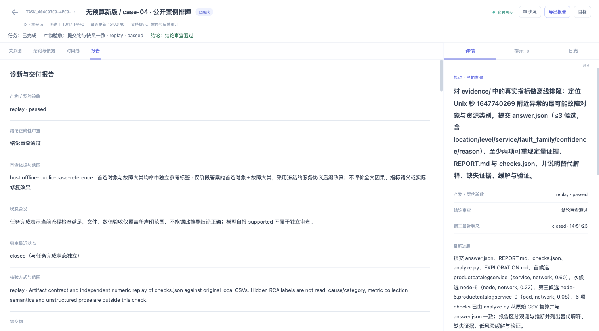
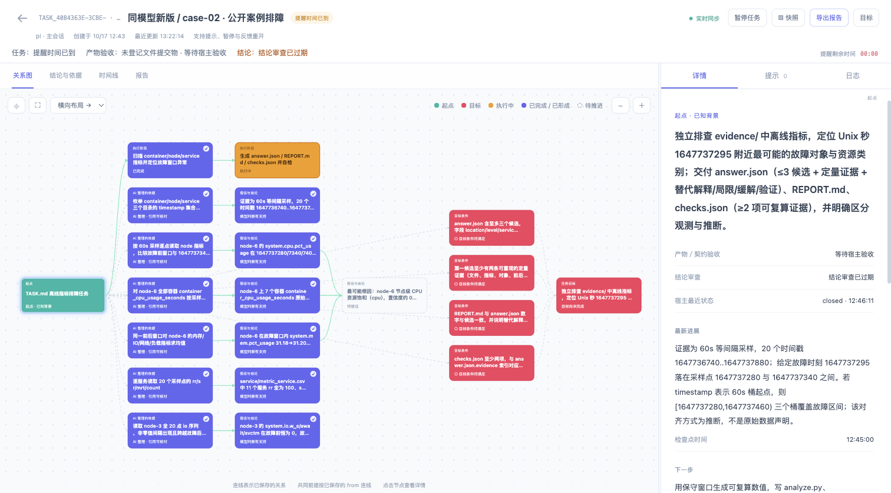
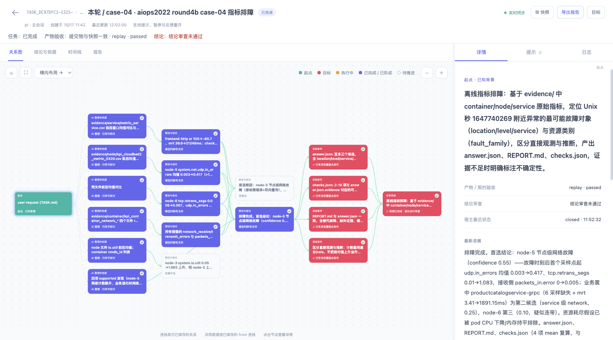

# 公开案例 UI 复盘入口

## 四模型难例对比（2026-10-17）

[打开 8012 看板](http://127.0.0.1:8012/)。本轮新增 **8 个 Cairn 任务**，合计 **49 个**，按模型及“上一版／本版”标记。原生 Pi 不生成 Cairn 任务图，其结果和成本见[四模型完整比较](../evaluations/public-rca/comparison-model-matrix.zh-CN.md)。

12 个全新会话均自然结束，无评测时限或输出预算；运行中按用户要求改为最多三路并行。隐藏标签成绩在所有执行者结束及报告审阅封存后生成。八个 Cairn 任务均完成且数值复算通过，限定范围的独立结论审查 5 个通过、3 个未通过。

| 模型 | 上一版 Cairn | 本版 Cairn |
|---|---|---|
| global:deepseek-v4.1-flash | [打开](http://127.0.0.1:8012/?run=2026-10-17-model-matrix-hardcase-unbudgeted&model=deepseek&case=case-03#task_7385dff8-9051-4dba-a49f-99c63ef26c6e) | [打开](http://127.0.0.1:8012/?run=2026-10-17-model-matrix-hardcase-unbudgeted&model=deepseek&case=case-03#task_e99d8837-497c-44f9-b3cc-9637a5cae62a) |
| cn:step-5-preview | [打开](http://127.0.0.1:8012/?run=2026-10-17-model-matrix-hardcase-unbudgeted&model=step&case=case-03#task_4c45909e-2706-45d6-ac84-b71bb4054fac) | [打开](http://127.0.0.1:8012/?run=2026-10-17-model-matrix-hardcase-unbudgeted&model=step&case=case-03#task_a2903d6b-5b5c-4b1a-a510-98cddfd943fc) |
| cn:glm-5.3 | [打开](http://127.0.0.1:8012/?run=2026-10-17-model-matrix-hardcase-unbudgeted&model=glm&case=case-03#task_adc15fd0-8d3f-4331-bedc-83b17190dccd) | [打开](http://127.0.0.1:8012/?run=2026-10-17-model-matrix-hardcase-unbudgeted&model=glm&case=case-03#task_bf84c04e-7581-4bac-916f-f3e95989c2be) |
| cn:kimi-k3-1 | [打开](http://127.0.0.1:8012/?run=2026-10-17-model-matrix-hardcase-unbudgeted&model=kimi&case=case-03#task_56d87147-adc8-4d5a-a1b6-25e66519afd4) | [打开](http://127.0.0.1:8012/?run=2026-10-17-model-matrix-hardcase-unbudgeted&model=kimi&case=case-03#task_60ed89ce-24ad-4c70-b217-b4a4f8468a0f) |

本版 DeepSeek、Kimi 均显示“任务完成＋产物验收通过＋结论审查未通过”；本版 Step、GLM 的标签审查通过。审查仅覆盖首选对象＋故障族，不证明全文、指标类型、物理单位或因果方向。八份原数据库状态、原有 41 个 UI 任务状态及核心源码校验未变；详情见[本轮源状态校验](../evaluations/public-rca/runs/2026-10-17-model-matrix-hardcase-unbudgeted/ui-source-validation.json)。

本版四份都有带来源的已保存交接，副本重载 4/4 通过；上一版也可重载原任务图，但没有这类自动交接包。未运行真实中断恢复，不能据此填写恢复成功率。终态交接的 next 仍可能过时。

本轮未新增浏览器截图：原浏览器任务空间已不存在，未另开空间绕过恢复限制。以上入口已核对数据库，尚未完成本轮浏览器画面复核。

## 第六轮无预算复验（历史，2026-10-17）

[打开 8012 看板](http://127.0.0.1:8012/)。该轮合计 **41 个任务**，本次新增八个，按“无预算旧版／新版”标记。三组四例均自然结束、完整保存交付物并通过复算；标签联合命中 Pi 3/4，两版 Cairn 4/4。原生 Pi 没有 Cairn 任务图，其结果见[无预算完整比较](../evaluations/public-rca/comparison-round6.zh-CN.md)。

| 案例 | 无预算旧版 | 无预算新版 |
| --- | --- | --- |
| case-01 | [打开](http://127.0.0.1:8012/?run=2026-10-17-aiops2022-round6-unbudgeted&case=case-01#task_08da8e50-7c24-4f8d-b4ed-2bbdf6d08eee) | [打开](http://127.0.0.1:8012/?run=2026-10-17-aiops2022-round6-unbudgeted&case=case-01#task_96e27473-3f5b-41d5-aed5-71271c5633ea) |
| case-02 | [打开](http://127.0.0.1:8012/?run=2026-10-17-aiops2022-round6-unbudgeted&case=case-02#task_4921dcf0-63d4-4a06-8365-cae2d13accda) | [打开](http://127.0.0.1:8012/?run=2026-10-17-aiops2022-round6-unbudgeted&case=case-02#task_13d5d537-2fd4-49c2-97ef-90772b2e3071) |
| case-03 | [打开](http://127.0.0.1:8012/?run=2026-10-17-aiops2022-round6-unbudgeted&case=case-03#task_b6c25ce9-08eb-4038-8753-3dffb859b19a) | [打开](http://127.0.0.1:8012/?run=2026-10-17-aiops2022-round6-unbudgeted&case=case-03#task_86e7c514-b937-4ca4-8b31-0bd037f58390) |
| case-04 | [打开](http://127.0.0.1:8012/?run=2026-10-17-aiops2022-round6-unbudgeted&case=case-04#task_42200486-4a81-4a98-800b-e016bdef7ce5) | [打开](http://127.0.0.1:8012/?run=2026-10-17-aiops2022-round6-unbudgeted&case=case-04#task_404c97c9-4fc9-400c-8176-5bb5b6c9abf9) |

顶部单列任务、产物验收和结论审查。报告页的独立审查仅覆盖首选对象＋故障大类，不证明全文、指标单位或因果机制。新版网络例可查看六份交接快照、来源 sessionRef 与报告定位；生成快照不等于后续模型已接管。全部隐藏评分在十二个执行者结束后导入复盘副本。

原始来源任务状态 **41/41**、实现文件 **85/85** 哈希未变。副本不重跑模型，不修改原始测试数据库。完整审计见[源状态检查](../evaluations/public-rca/runs/2026-10-17-aiops2022-round6-unbudgeted/ui-source-validation.json)。

本轮真实截图：

## 第五轮同模型复验（历史）

本轮三组同模型实验已结束，8012 看板合计 **33 个任务**，新增 15 个新旧 Cairn 主任务／续接任务。原生 Pi 文件结果见[完整比较](../evaluations/public-rca/comparison-round5.zh-CN.md)。复盘副本按“同模型旧版／新版”标记，不会重跑模型。

| 案例 | 同模型旧版主阶段 | 旧版恢复 | 同模型新版主阶段 | 新版恢复 |
| --- | --- | --- | --- | --- |
| case-01 | [打开](http://127.0.0.1:8012/?run=2026-10-17-aiops2022-round5&case=case-01#task_0ade5c71-ccda-4203-a912-b49683f01658) | [打开](http://127.0.0.1:8012/?run=2026-10-17-aiops2022-round5&case=case-01#task_7b173315-c8b1-4392-aaf0-2b0f2ecb232c) | [打开](http://127.0.0.1:8012/?run=2026-10-17-aiops2022-round5&case=case-01#task_36322347-a22c-4380-bdcf-dbdd7aa6259b) | [打开](http://127.0.0.1:8012/?run=2026-10-17-aiops2022-round5&case=case-01#task_68499580-22ed-41f7-8b60-eb635135b5de) |
| case-02 | [打开](http://127.0.0.1:8012/?run=2026-10-17-aiops2022-round5&case=case-02#task_d4b7fae2-6d3c-4ef6-876a-4bb1437ddb93) | [打开](http://127.0.0.1:8012/?run=2026-10-17-aiops2022-round5&case=case-02#task_aceae5ea-d2b2-4fd4-b12d-3678556c720c) | [打开](http://127.0.0.1:8012/?run=2026-10-17-aiops2022-round5&case=case-02#task_4084363e-3cbe-4d76-b709-c78a74f8212c) | [打开](http://127.0.0.1:8012/?run=2026-10-17-aiops2022-round5&case=case-02#task_ebc7ec22-9ac1-4e73-bab2-82dc6723a139) |
| case-03 | [打开](http://127.0.0.1:8012/?run=2026-10-17-aiops2022-round5&case=case-03#task_612b7dd0-6942-4431-af48-7c96695e6ed7) | [打开](http://127.0.0.1:8012/?run=2026-10-17-aiops2022-round5&case=case-03#task_9da9ce75-aa3f-4336-a996-905198b877ed) | [打开](http://127.0.0.1:8012/?run=2026-10-17-aiops2022-round5&case=case-03#task_c7b57e5e-b102-4d19-a85f-cb05f344a6ee) | [打开](http://127.0.0.1:8012/?run=2026-10-17-aiops2022-round5&case=case-03#task_22bd9aed-9aeb-45a9-8549-d15241da8350) |
| case-04 | [打开](http://127.0.0.1:8012/?run=2026-10-17-aiops2022-round5&case=case-04#task_89f68622-fe9d-4d5a-baa6-f423395b56fe) | [打开](http://127.0.0.1:8012/?run=2026-10-17-aiops2022-round5&case=case-04#task_1db17387-25b7-4357-add8-7f73a9b9c96b) | [打开](http://127.0.0.1:8012/?run=2026-10-17-aiops2022-round5&case=case-04#task_a255410d-b980-44bd-8ccc-8b655a39eb50) | 未创建续接任务 |

十二个主阶段均未完成完整交付；旧版四次恢复成功，新版前三次恢复成功，网络例恢复失败且没有创建续接任务。完成的恢复任务显示 replay passed 与限定范围的结论审查通过，全文语义仍有独立审阅问题。

CPU 新版主任务虽然保存了一个标签命中的部分答案，但没有完整提交物快照，UI 保守显示“等待宿主验收／结论审查已过期”；其恢复任务才是完整交付。没有有效阶段答案时审查记录为 inconclusive，若要求的候选快照不完整，当前审查也会过期。新版网络主任务没有 Finding，显示“结论未评定”，只有空的创建交接；不能以有一个 Markdown 文件就声称保存了探索知识。

报告页可查看自动交接的摘要、报告路径与原生 sessionRef。`saved` 不表示已接收或接管；旧任务未完成状态仍保留。来源状态 **33/33 哈希未变**。本轮真实截图：



## 前四轮历史入口

本地看板：[打开任务列表](http://127.0.0.1:8012/)。前四轮保留 **18 个 Cairn 任务**：16 个主任务与本轮两个恢复任务。来源状态 18/18 哈希核对未变；复盘副本仅追加轮次／案例标题、限定范围的离线结论审查和对应事件。每个任务原历史保留，全局 seq 重新编号。来源与校验值见 [manifest.json](../evaluations/public-rca/runs/ui-review-2026-10-17/manifest.json)。

| 案例 | 第一轮 | 第二轮 | 上一轮 | 本轮 |
| --- | --- | --- | --- | --- |
| case-01 写 I/O | [打开](http://127.0.0.1:8012/?run=2026-10-16-aiops2022&case=case-01#task_c77bd37e-e9fd-4908-be41-2599ebf8343f) | [打开](http://127.0.0.1:8012/?run=2026-10-16-aiops2022-round2b&case=case-01#task_f670c1d1-048c-43bf-a456-c1d68af9e772) | [打开](http://127.0.0.1:8012/?run=2026-10-17-aiops2022-round3c&case=case-01#task_4d401cf1-76ed-41e5-be2c-85f3e6d7e910) | [打开](http://127.0.0.1:8012/?run=2026-10-17-aiops2022-round4b&case=case-01#task_63ecb5c1-201d-4cf6-a4b8-3c2cd2feb907) |
| case-02 节点 CPU | [打开](http://127.0.0.1:8012/?run=2026-10-16-aiops2022&case=case-02#task_e1e8eb78-c450-4c83-b40c-5f54b68f55ef) | [打开](http://127.0.0.1:8012/?run=2026-10-16-aiops2022-round2b&case=case-02#task_efb19b00-6430-4399-b98b-7b3615295cbb) | [打开](http://127.0.0.1:8012/?run=2026-10-17-aiops2022-round3c&case=case-02#task_f09ff292-c6e3-4aab-806f-ff23f2f42177) | [打开](http://127.0.0.1:8012/?run=2026-10-17-aiops2022-round4b&case=case-02#task_52176f49-7044-485f-82e8-e92b0c46ac50) |
| case-03 容器内存 | [打开](http://127.0.0.1:8012/?run=2026-10-16-aiops2022&case=case-03#task_5629cbc8-8508-4af3-8303-d8669346176c) | [打开](http://127.0.0.1:8012/?run=2026-10-16-aiops2022-round2b&case=case-03#task_c4bd03b3-3248-40c3-be8d-b8caab68cfad) | [打开](http://127.0.0.1:8012/?run=2026-10-17-aiops2022-round3c&case=case-03#task_488401af-5906-4f51-a065-d49f4a8cace6) | [打开](http://127.0.0.1:8012/?run=2026-10-17-aiops2022-round4b&case=case-03#task_9f7748e7-926f-4860-b50b-0643b5890629) |
| case-04 服务网络 | [打开](http://127.0.0.1:8012/?run=2026-10-16-aiops2022&case=case-04#task_8c40f7a3-283d-4ba6-b177-ba33282805d3) | [打开](http://127.0.0.1:8012/?run=2026-10-16-aiops2022-round2b&case=case-04#task_e10fba97-a39f-472a-8587-33393d8095d3) | [打开](http://127.0.0.1:8012/?run=2026-10-17-aiops2022-round3c&case=case-04#task_cb411752-f432-42ec-b435-9869e09213e3) | [打开](http://127.0.0.1:8012/?run=2026-10-17-aiops2022-round4b&case=case-04#task_dc97dfc2-1325-45ad-876e-c96fb1966018) |

第四轮恢复为独立续接任务，原主任务状态保留：

- [case-01 恢复](http://127.0.0.1:8012/?run=2026-10-17-aiops2022-round4b&case=case-01#task_db44bea7-f16e-4c23-b6c6-029378da70cc)：I/O 恢复仍未完成，达到 180 秒时限。
- [case-02 恢复](http://127.0.0.1:8012/?run=2026-10-17-aiops2022-round4b&case=case-02#task_577c1432-2e85-4e20-835f-ccb173fbb4ba)：CPU 续接已完成；原答案文件未变。

## 怎么读状态

顶部并列三项：**任务状态、产物／契约验收、结论审查**。第四轮网络例实测为“任务已完成＋replay passed＋结论审查未通过”；CPU 主任务为未完成／提醒时间已到，结论审查通过，而其续接任务已完成。它们表达不同事实。

- **关系图**：看已保存的事实、假设和共同前提。supported 标为“模型判断有支持”；连线和条件覆盖不证明真实因果或根因命中。
- **结论与依据**：检查观测与解释是否混写、反证是否保留。第四轮内存与网络例有中途结构化 checkpoint；前两例主要写摘要。
- **时间线**：看 checkpoint、被拒 finish、验收、任务完成与独立审查事件。新会话接手不等于旧任务已完成。
- **报告**：看验收 method／scope、文件哈希及独立审查来源。离线标签审查只覆盖首选对象＋故障大类，不评价全文因果、采集语义或修复效果；未提供审查时默认未评定。

第四轮独立评分在八个主阶段及必要恢复全部结束后导入 UI 副本，没有反馈给运行模型。Pi 产物、原始与复核成绩以及完整成本见 [第四轮比较](../evaluations/public-rca/comparison-round4.zh-CN.md)。第四轮 handoff 为零，不能从文件存在推导“已完成分层交接”。

复盘副本不会随原测试更新，“实时同步”仅表示这份副本的连接。副本上的提示、暂停或重开不会重新运行原模型。旧任务由当前 UI 投影，历史成绩以各轮冻结报告为准。

第四轮真实截图：

## 重新启动

8012 已启动；原 8000 属于另一个数据库。停止后，从仓库根目录用 Node 24+：

```sh
node dist/cairn.mjs ui --db /Users/shen/Documents/Code/Cairn/evaluations/public-rca/runs/ui-review-2026-10-17/state.db --port 8012
```

使用仓库 bundle 显示最新字段。运行库与复盘副本属于本地 ignored 材料，其他机器需要重建输入和运行记录。
